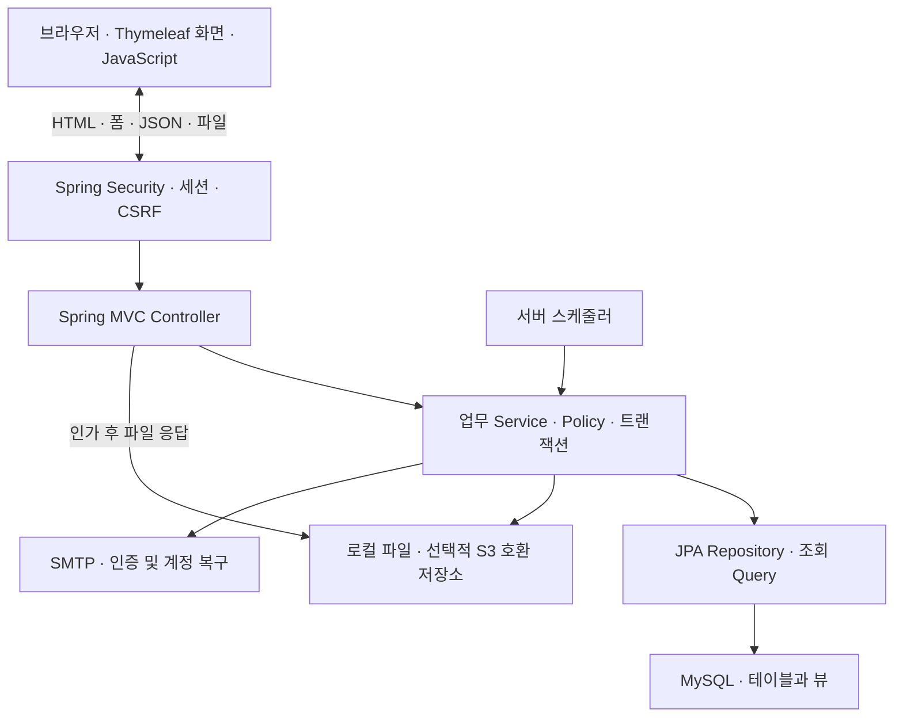
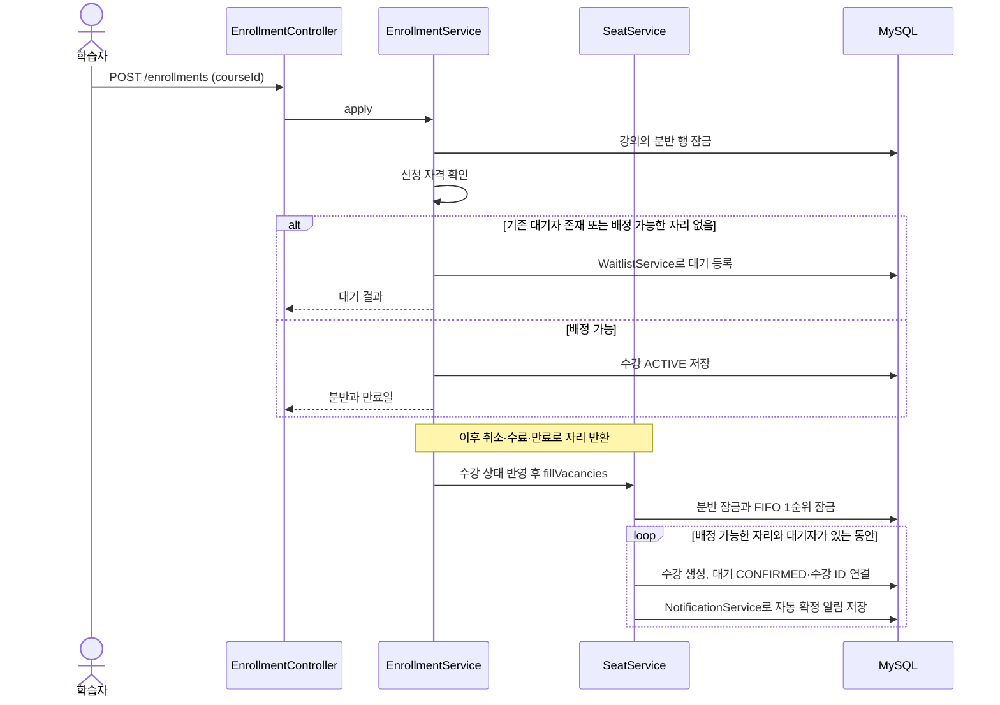
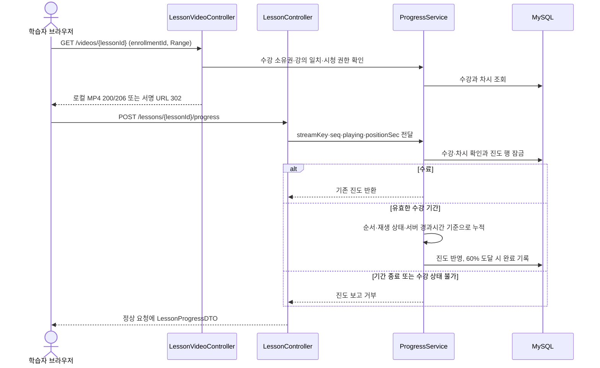
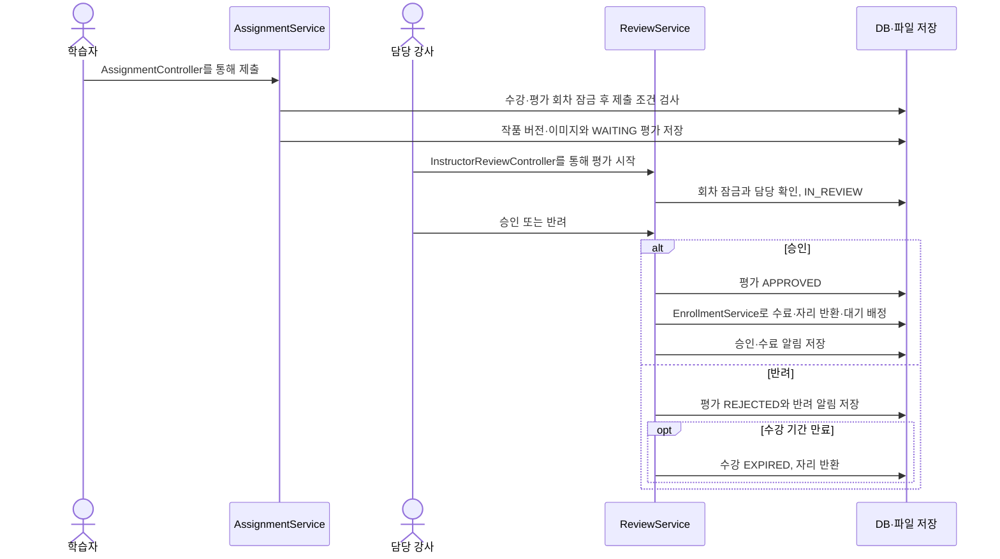
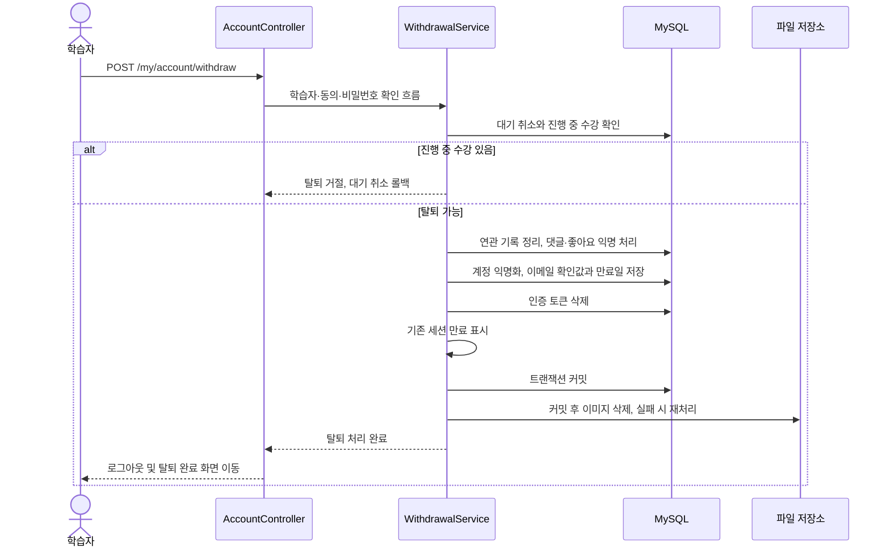

# 놀이방 LMS · 백엔드 아키텍처와 핵심 시퀀스

2026-11-12. 시퀀스는 주요 호출과 상태 전이를 보여 주며, 입력 검증과 화면 모델 구성은 필요한 곳에 표시했다.

## 1. 시스템 구성

Spring MVC가 화면과 일부 JSON·파일 엔드포인트를 제공한다. 세션과 역할 경계는 필터에서 확인하고, 수강 소유권·현재 담당 강사·작품 가시성 등은 업무 로직에서 검사한다. MySQL은 상태와 파일 키를 저장한다. 기본 파일 저장 방식은 로컬이며, S3 호환 모드에서도 강사·관리자 업로드 영상은 서버의 로컬 폴더에 저장한다. 서버 스케줄러는 수강 만료, 탈퇴 이메일 확인값 정리, 실패한 파일 삭제 재처리를 수행한다.

## 2. 수강 신청과 대기열 자동 확정

배정은 담당 강사가 있는 분반의 남은 자리 내림차순, 동률이면 분반 번호 오름차순이다. 신청과 자동 확정이 분반 잠금을 사용하며, 자동 확정은 수강 행을 먼저 저장한 뒤 대기 행에 연결한다. 만료 스케줄러도 자리가 반환되는 흐름을 호출한다.

## 3. 영상 접근과 진도 누적

로컬 영상에 잘못된 Range를 보내면 416을 반환한다. 수료자는 영상을 다시 볼 수 있고, 다시 보기로 진도는 갱신되지 않는다.

## 4. 최종 과제 제출부터 승인·반려까지

승인과 수료, 후속 자리 배정, DB 알림 저장은 같은 트랜잭션에 속한다. 평가 대기 중 수정은 기존 버전을 갱신한다. 기간 내 반려 후 재제출은 새 작품 버전과 새 평가 회차를 만든다. 제출 마감 전에 올라온 과제는 수강 기간이 지난 뒤에도 평가할 수 있다.

## 5. 회원 탈퇴와 파일 정리

서비스는 같은 계정의 기존 세션에 만료를 표시하고, Controller는 현재 요청의 세션을 로그아웃한다. DB 롤백 시 커밋 후 이미지 삭제 작업은 실행되지 않는다.

## 코드 근거

- [SecurityConfig](https://github.com/Bug-girllim/Nolibang/blob/8bca4ade831ce36001b9ce7e7335804d293ff63c/src/main/java/com/wanted/lmspractice/global/config/SecurityConfig.java)
- [EnrollmentService](https://github.com/Bug-girllim/Nolibang/blob/8bca4ade831ce36001b9ce7e7335804d293ff63c/src/main/java/com/wanted/lmspractice/domain/enrollment/service/EnrollmentService.java)
- [SeatService](https://github.com/Bug-girllim/Nolibang/blob/8bca4ade831ce36001b9ce7e7335804d293ff63c/src/main/java/com/wanted/lmspractice/domain/enrollment/service/SeatService.java)
- [EnrollmentExpiryService](https://github.com/Bug-girllim/Nolibang/blob/8bca4ade831ce36001b9ce7e7335804d293ff63c/src/main/java/com/wanted/lmspractice/domain/enrollment/service/EnrollmentExpiryService.java)
- [LessonVideoController](https://github.com/Bug-girllim/Nolibang/blob/8bca4ade831ce36001b9ce7e7335804d293ff63c/src/main/java/com/wanted/lmspractice/domain/learning/controller/LessonVideoController.java)
- [ProgressService](https://github.com/Bug-girllim/Nolibang/blob/8bca4ade831ce36001b9ce7e7335804d293ff63c/src/main/java/com/wanted/lmspractice/domain/learning/service/ProgressService.java)
- [AssignmentService](https://github.com/Bug-girllim/Nolibang/blob/8bca4ade831ce36001b9ce7e7335804d293ff63c/src/main/java/com/wanted/lmspractice/domain/review/service/AssignmentService.java)
- [ReviewService](https://github.com/Bug-girllim/Nolibang/blob/8bca4ade831ce36001b9ce7e7335804d293ff63c/src/main/java/com/wanted/lmspractice/domain/review/service/ReviewService.java)
- [WithdrawalService](https://github.com/Bug-girllim/Nolibang/blob/8bca4ade831ce36001b9ce7e7335804d293ff63c/src/main/java/com/wanted/lmspractice/domain/user/service/WithdrawalService.java)
- [AccountController](https://github.com/Bug-girllim/Nolibang/blob/8bca4ade831ce36001b9ce7e7335804d293ff63c/src/main/java/com/wanted/lmspractice/domain/user/controller/AccountController.java)
- [FileDeleteRetryScheduler](https://github.com/Bug-girllim/Nolibang/blob/8bca4ade831ce36001b9ce7e7335804d293ff63c/src/main/java/com/wanted/lmspractice/global/file/FileDeleteRetryScheduler.java)
