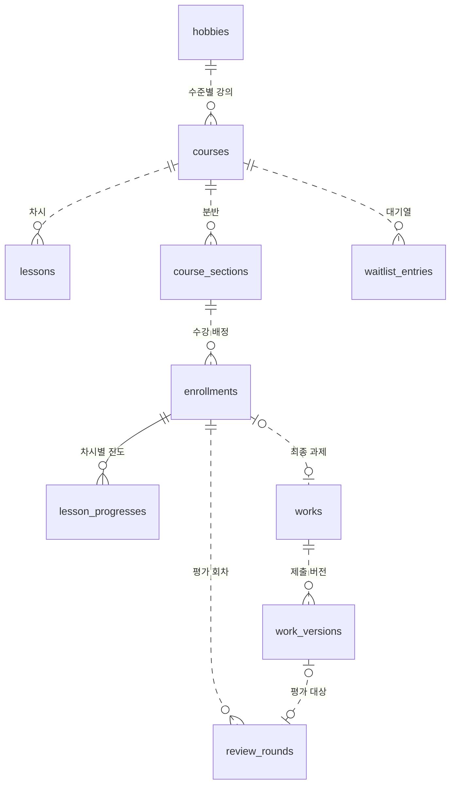
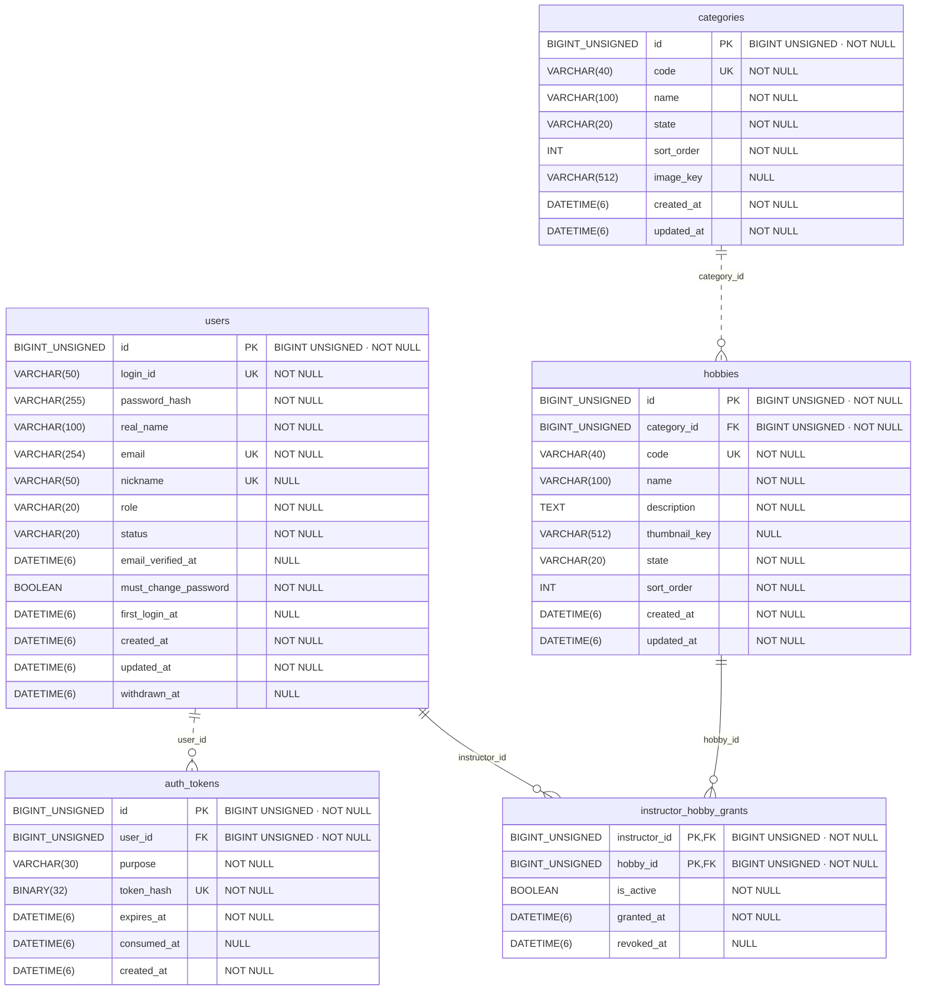
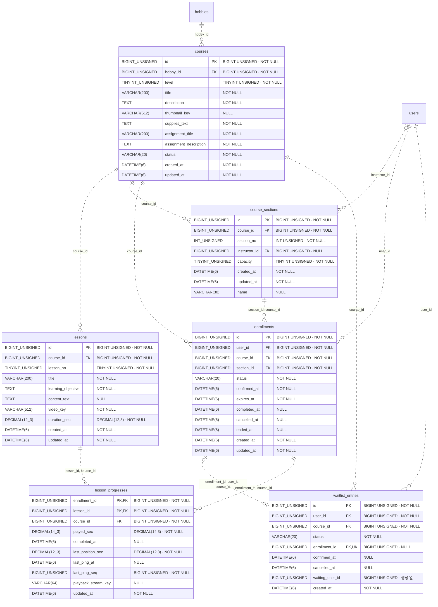
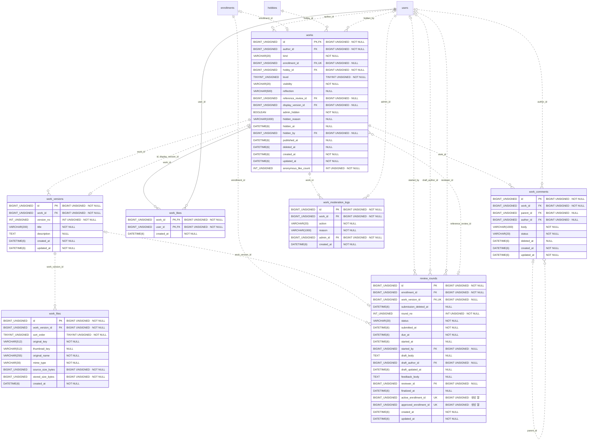
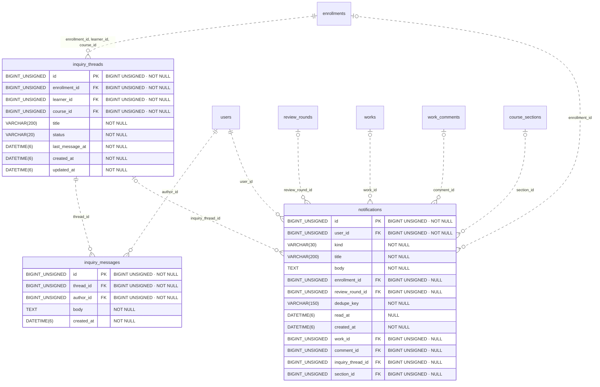
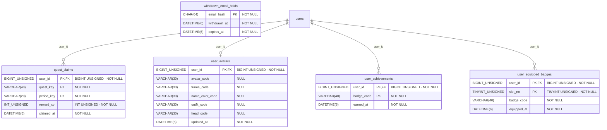

# 놀이방 LMS 최신 ERD

2026-11-12 기준으로 작성했다.

**테이블 26개 · 외래 키 50개 · 최종 뷰 6개**

## 핵심 관계

아래 영역별 ERD에는 해당 영역 테이블이 가진 모든 FK와 전체 컬럼을 표시했다. 다른 영역에서 참조하는 테이블은 이름만 표시한다. 카디널리티는 SQL의 NULL과 UNIQUE 제약을 기준으로 한다. 실선은 자식 PK에 FK가 포함된 식별 관계, 점선은 비식별 관계다. 컬럼의 UK는 단일 열 유니크이며, 복합 유니크 제약은 각 그림 아래에 적었다.

## 1. 계정과 취미 분류

## 2. 강의·분반·수강·대기·진도

- `courses` 복합 UNIQUE `(hobby_id, level)`
- `lessons` 복합 UNIQUE `(course_id, lesson_no)`, `(id, course_id)`
- `course_sections` 복합 UNIQUE `(course_id, section_no)`, `(id, course_id)`, `(course_id, name)`
- `enrollments` 복합 UNIQUE `(user_id, course_id)`, `(id, course_id)`, `(id, user_id, course_id)`
- `waitlist_entries` 복합 UNIQUE `(course_id, waiting_user_id)`

강의별 차시는 서비스에서 3차시로 구성한다. ERD의 0..N은 FK가 보장하는 범위다. 대기열의 `waiting_user_id`는 대기 상태일 때만 채워지는 생성 열이다.

## 3. 작품·과제 평가·게시판

- `work_versions` 복합 UNIQUE `(work_id, version_no)`, `(work_id, id)`
- `work_files` 복합 UNIQUE `(work_version_id, sort_order)`
- `review_rounds` 복합 UNIQUE `(enrollment_id, round_no)`

`works.enrollment_id`는 NULL을 허용해 수강 연결이 없는 일반 작품도 저장할 수 있다. 평가의 `active_enrollment_id`와 `approved_enrollment_id`는 상태별 생성 열이며 각각의 UNIQUE가 수강당 해당 상태의 평가 수를 제한한다.

## 4. 1:1 문의와 알림

- `notifications` 복합 UNIQUE `(user_id, dedupe_key)`

문의의 `learner_id`와 `course_id`는 수강을 참조하는 복합 FK의 구성 열이다. 알림의 대상 열들은 개별적으로 NULL을 허용하며, 종류별 필수 대상은 CHECK로 검사한다.

## 5. 성장 기록과 탈퇴 이메일 보관

- `user_equipped_badges` 복합 UNIQUE `(user_id, badge_code)`

`user_equipped_badges`는 슬롯 1–3을 허용하며, `badge_code`는 획득 기록으로의 FK가 없다. `withdrawn_email_holds`는 사용자 FK 없이 이메일 해시를 PK로 사용하며, 만료일은 탈퇴 시각으로부터 30일이다.

## 6. 외래 키 제약 전체 목록

| 자식 테이블 · 열 | 부모 테이블 · 열 | 제약명 | ON DELETE |
| --- | --- | --- | --- |
| `auth_tokens(user_id)` | `users(id)` | `fk_auth_user` | 기본값 |
| `hobbies(category_id)` | `categories(id)` | `fk_hobbies_category` | 기본값 |
| `instructor_hobby_grants(instructor_id)` | `users(id)` | `fk_grant_instructor` | 기본값 |
| `instructor_hobby_grants(hobby_id)` | `hobbies(id)` | `fk_grant_hobby` | 기본값 |
| `courses(hobby_id)` | `hobbies(id)` | `fk_courses_hobby` | 기본값 |
| `lessons(course_id)` | `courses(id)` | `fk_lessons_course` | 기본값 |
| `course_sections(course_id)` | `courses(id)` | `fk_sections_course` | 기본값 |
| `course_sections(instructor_id)` | `users(id)` | `fk_sections_instructor` | 기본값 |
| `enrollments(user_id)` | `users(id)` | `fk_enroll_user` | 기본값 |
| `enrollments(course_id)` | `courses(id)` | `fk_enroll_course` | 기본값 |
| `enrollments(section_id, course_id)` | `course_sections(id, course_id)` | `fk_enroll_section` | 기본값 |
| `waitlist_entries(user_id)` | `users(id)` | `fk_wait_user` | 기본값 |
| `waitlist_entries(course_id)` | `courses(id)` | `fk_wait_course` | 기본값 |
| `waitlist_entries(enrollment_id, user_id, course_id)` | `enrollments(id, user_id, course_id)` | `fk_wait_enrollment` | 기본값 |
| `lesson_progresses(enrollment_id, course_id)` | `enrollments(id, course_id)` | `fk_progress_enrollment` | 기본값 |
| `lesson_progresses(lesson_id, course_id)` | `lessons(id, course_id)` | `fk_progress_lesson` | 기본값 |
| `works(author_id)` | `users(id)` | `fk_works_author` | 기본값 |
| `works(enrollment_id)` | `enrollments(id)` | `fk_works_enrollment` | 기본값 |
| `works(hobby_id)` | `hobbies(id)` | `fk_works_hobby` | 기본값 |
| `works(hidden_by)` | `users(id)` | `fk_works_moderator` | 기본값 |
| `works(reference_review_id)` | `review_rounds(id)` | `fk_works_reference` | 기본값 |
| `works(id, display_version_id)` | `work_versions(work_id, id)` | `fk_works_display` | 기본값 |
| `work_versions(work_id)` | `works(id)` | `fk_versions_work` | 기본값 |
| `work_files(work_version_id)` | `work_versions(id)` | `fk_files_version` | CASCADE |
| `review_rounds(enrollment_id)` | `enrollments(id)` | `fk_reviews_enrollment` | 기본값 |
| `review_rounds(work_version_id)` | `work_versions(id)` | `fk_reviews_version` | 기본값 |
| `review_rounds(started_by)` | `users(id)` | `fk_reviews_starter` | 기본값 |
| `review_rounds(draft_author_id)` | `users(id)` | `fk_reviews_draft_author` | 기본값 |
| `review_rounds(reviewer_id)` | `users(id)` | `fk_reviews_reviewer` | 기본값 |
| `notifications(user_id)` | `users(id)` | `fk_notifications_user` | 기본값 |
| `notifications(enrollment_id)` | `enrollments(id)` | `fk_notifications_enrollment` | 기본값 |
| `notifications(review_round_id)` | `review_rounds(id)` | `fk_notifications_review` | 기본값 |
| `notifications(work_id)` | `works(id)` | `fk_notifications_work` | 기본값 |
| `notifications(comment_id)` | `work_comments(id)` | `fk_notifications_comment` | 기본값 |
| `notifications(inquiry_thread_id)` | `inquiry_threads(id)` | `fk_notifications_inquiry` | 기본값 |
| `notifications(section_id)` | `course_sections(id)` | `fk_notifications_section` | 기본값 |
| `work_likes(work_id)` | `works(id)` | `fk_likes_work` | 기본값 |
| `work_likes(user_id)` | `users(id)` | `fk_likes_user` | 기본값 |
| `work_comments(work_id)` | `works(id)` | `fk_comments_work` | 기본값 |
| `work_comments(parent_id)` | `work_comments(id)` | `fk_comments_parent` | 기본값 |
| `work_comments(author_id)` | `users(id)` | `fk_comments_author` | 기본값 |
| `inquiry_threads(enrollment_id, learner_id, course_id)` | `enrollments(id, user_id, course_id)` | `fk_inquiry_enrollment` | 기본값 |
| `inquiry_messages(thread_id)` | `inquiry_threads(id)` | `fk_inquiry_messages_thread` | 기본값 |
| `inquiry_messages(author_id)` | `users(id)` | `fk_inquiry_messages_author` | 기본값 |
| `work_moderation_logs(work_id)` | `works(id)` | `fk_modlogs_work` | 기본값 |
| `work_moderation_logs(admin_id)` | `users(id)` | `fk_modlogs_admin` | 기본값 |
| `quest_claims(user_id)` | `users(id)` | `fk_quest_claims_user` | 기본값 |
| `user_avatars(user_id)` | `users(id)` | `fk_user_avatars_user` | 기본값 |
| `user_achievements(user_id)` | `users(id)` | `fk_user_achievements_user` | 기본값 |
| `user_equipped_badges(user_id)` | `users(id)` | `fk_equipped_badges_user` | 기본값 |

## 7. 조회용 뷰

| 뷰 | 주요 참조 | 용도 |
| --- | --- | --- |
| `v_section_current_stats` | `course_sections`, `enrollments`, `review_rounds` | 분반별 수강·수료·최신 평가 상태 집계 |
| `v_section_seats` | `course_sections`, `enrollments` | 분반의 남은 자리와 배정 가능 여부 |
| `v_section_stats_screen` | `course_sections`, `enrollments`, `review_rounds` | 화면용 분반 통계와 누적 반려 횟수 |
| `v_user_level_badges` | `enrollments`, `courses` | 취미·수준별 수료 배지 산출 |
| `v_user_master_badges` | `v_user_level_badges` | 같은 취미의 3개 수준 수료로 마스터 배지 산출 |
| `v_public_works` | `works`, `work_versions`, `users`, `work_likes` | 공개 작품 조회. 좋아요 행 수와 익명 보존 좋아요를 합산 |
