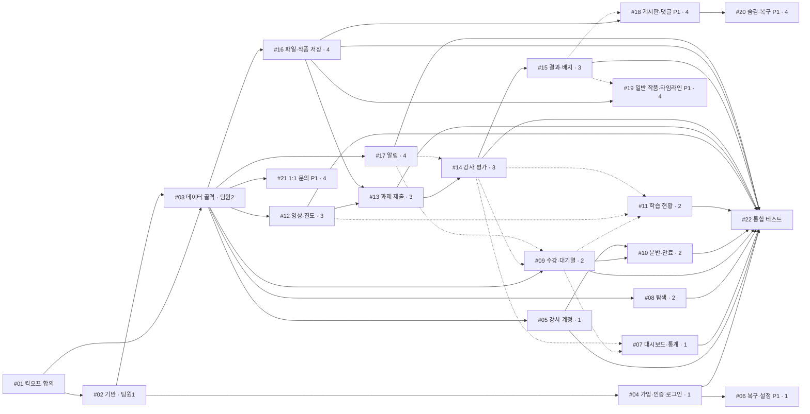

# 놀이방 LMS — 4인 작업 분배 · GitHub Issue · PR 전략

> **기준 자료:** `배운기술/배운기술_정리.md`, `패키지_구조_설계.md`(11-06 최종: 기존 기획 유지, Thymeleaf), `기획/` 12개 문서(11-05 D-51~D-59 우선), `html/` 시안(강의·카테고리 관리 화면 제외)
> **표기:** ✅ 확정(자료 근거 있음) · 💡 제안(이 문서가 제안하는 구조, 팀 합의 필요) · ❓ 미확정(자료 없음) · 🟢 배운 기술 · 🟡 안 배운 기술
> **패키지명:** `com.wanted.lmspractice` (11-06 확정). 경로는 `src/main/java/com/wanted/lmspractice/...`.
> **DB:** `데이터베이스/` 스키마 + 11-06 팀 결정 반영본 `schema.sql`·`seed.sql` (11-06 확정). 엔티티·enum은 DB와 1:1로 맞춰 스켈레톤에 이미 들어 있다.
> **팀원 이름:** 제공되지 않아 **팀원 1~4**로 표기한다.

## 목차

1. 프로젝트 구조 및 기능 분석
2. 4명 팀원별 작업 분배표
3. GitHub Issue 전체 목록
4. 각 이슈의 상세 본문 (복사용)
5. 이슈 간 의존성 및 개발 순서
6. 권장 PR 구성과 CodeRabbit 리뷰 최적화 전략
7. 팀원 간 사전 합의가 필요한 인터페이스 목록
8. 프로젝트 시작 전 확인해야 할 미확정 사항
9. 이렇게 나눈 이유 (설계 근거 요약)

---

## 1. 프로젝트 구조 및 기능 분석

### 1-1. 구현해야 하는 전체 기능 목록

✅ = 기획 확정 범위. P2·확장·범위 제외는 이번 이슈에서 다루지 않는다(§1-6).

| 그룹 | FR | 기능 | 등급 | 화면 |
|---|---|---|---|---|
| 계정 | FR-001 | 학습자 가입(아이디·비밀번호·실명·이메일), 이메일 인증, 이메일 고유 | P0 | C-03, C-04 |
| 계정 | FR-002 | 닉네임 중복 불가, 미입력 시 "형용사+동물+1~999" 생성 | P0 | C-03 |
| 계정 | FR-003 | 가입 후 별도 로그인, 첫 로그인 → 취미 탐색 / 이후 → 홈 | P0 | C-02 |
| 계정 | FR-012 | 관리자 강사 계정 생성(임시 비밀번호), 첫 로그인 변경 강제, 재발급, 취미 권한, 분반 담당 | P0 | A-S04, C-09, A-S05 |
| 계정 | FR-004 | 아이디 찾기·비밀번호 재설정(이메일) | P1 | C-05 |
| 계정 | FR-005 | 한 계정 한 기기, 1시간 유휴 만료 (재생 중 연장은 ❓) | P1 | — |
| 계정 | — | 계정 설정(닉네임 수정 등) | — ❓ 등급 없음(화면 U-S17만 존재) | U-S17 |
| 탐색 | FR-010 | 대분류·세부 취미 운영/준비 중/비공개 노출 | P0 | U-S01, U-S02, A-S15 |
| 탐색 | FR-013 | 9강의 × 3차시, 준비물, 강의 상세 | P0 | U-S03, U-S04 |
| 수강 | FR-015, FR-055 | 중복 신청 금지, 수료·취소·만료 강의 재신청 불가 | P0 / P1 | U-S05 |
| 수강 | FR-052 | 분반 정원 1~30, 남은 자리 최대 분반 자동 배정, 대기자 우선 | P0 | U-S05, A-S05 |
| 수강 | FR-053 | 강의별 단일 대기열(FIFO), 자리 반환 시 1순위 자동 확정 + 알림, 관리자 조회 | P0 | U-S05, A-S12 |
| 수강 | FR-054 | 수강 확정 + 30일, 정원 점유/반환, 수강 취소, 만료 처리 | P0 | U-S05, U-S08 |
| 학습 | FR-020 | 차시별 실제 재생 60% 완료 | P0 | U-S06 |
| 학습 | FR-054(D-42) | 영상 접근 = 수강 30일 이내 또는 수료자 | P0 | U-S06 |
| 학습 | FR-029 | 나의 학습 현황(본인만) | P0 | U-S08 |
| 과제 | FR-021, FR-022 | 3차시 완료 후 제출, 이미지 1~5장·장당 50MB, 전부 성공해야 제출 | P0 | U-S07 |
| 과제 | FR-026 | 평가 시작 전 수정(기한 불변), 반려 후 정식 재제출(새 7일), 23일 경과 안내 | P1 | U-S07 |
| 평가 | FR-023, FR-030, FR-031 | 평가 시작(잠금) → 초안 → 승인(피드백 50자)/반려(사유 50자), 시작 취소, 7일 마감·임박·초과, 수료 | P0 | T-S03, T-S04 |
| 평가 | FR-024, FR-025 | 수준·마스터 배지, 시각 구분 표시 | P1 | U-S14, U-S13 |
| 알림 | FR-035 | 사이트 알림(평가 결과·자동 확정·수료), 알림함 | P0 | U-S15, T-S09 |
| 강사 LMS | FR-051 | 강사 통계(분반별 수강 중·수료·반려·평가 대기 수) | P0 | T-S05, A-S13 |
| 강사 LMS | — (05 §7-0 ✅) | 강사 홈·담당 분반, 담당 학습자 관리 | P0 범위로 해석 ❓ | T-S01, T-S02 |
| 관리자 | D-59 | 관리자 홈 | P0 | A-S01 |
| 작품 | FR-027, FR-028 | 일반 작품 등록, 성장 타임라인·회고·참고 피드백 | P1 | U-S11, U-S12 |
| 작품 | FR-033, FR-034 | 게시판·검색·필터·정렬, 좋아요·댓글·답글 | P1 | U-S09, U-S10, T-S10 |
| 작품 | FR-036 | 관리자 공개 작품 숨김·복구, 사유 확인 | P1 | A-S08, A-S14, U-S16 |
| 문의 | FR-042 | 1:1 문의 | P1 | U-S18, T-S06 |
| 공통 | NFR-01~05 | 서버 권한 검사, 비밀번호 해시, 동시성·중복 일관성, 실명 비공개, 미디어 | — | C-06, E-* |

### 1-2. 기능별 패키지·클래스 (💡 `패키지_구조_설계.md` 기준 제안 구조)

| 패키지 | 주요 클래스 | 담당 기능 |
|---|---|---|
| `global.config` | `SecurityConfig`, `WebConfig`, `PasswordChangeInterceptor` | 권한·로그인·세션, 인터셉터 |
| `global.exception` | `BusinessException`, `ErrorCode`, `GlobalExceptionHandler` | 전역 예외·오류 화면 |
| `global.file` | `FileStorage` | 업로드 파일 저장·읽기·삭제 |
| `global.controller` | `MainController` | 메인 홈, 개인정보 처리방침 |
| `domain.auth` | `AuthController`, `EmailVerifyController`, `AccountRecoveryController`, `InstructorSetupController`, `AuthSuccessHandler`, `AuthFailHandler`, `AuthDetails`, `AuthService`, `EmailVerificationService` | 로그인·인증·복구·강사 첫 로그인 |
| `domain.user` | `SignupController`, `AccountController`, `AdminInstructorController`, `User`, `Role`, `AuthToken`, `InstructorHobbyGrant`, `UserService`, `InstructorAccountService`, `NicknamePolicy` | 회원·강사 계정 |
| `domain.hobby` | `HobbyController`, `AdminHobbyController`, `Category`, `Hobby`, `HobbyService` | 취미 탐색 (조회 전용) |
| `domain.course` | `CourseController`, `Course`, `Lesson`, `CourseService` | 강의 조회 (조회 전용) |
| `domain.enrollment` | `EnrollmentController`, `AdminSectionController`, `AdminWaitlistController`, `CourseSection`, `Enrollment`, `WaitlistEntry`, `EnrollmentService`, `WaitlistService`, `SeatService`, `SectionService`, `SectionAssignPolicy`, `EnrollEligibilityPolicy`, `EnrollmentExpiryScheduler` | 수강·분반·대기열·만료 |
| `domain.learning` | `LessonController`, `LessonVideoController`, `MyLearningController`, `LessonProgress`, `ProgressService`, `MyLearningService`, `VideoAccessPolicy` | 영상 학습·진도·학습 현황 |
| `domain.review` | `AssignmentController`, `InstructorReviewController`, `ReviewRound`, `ReviewService`, `AssignmentService`, `BadgeService`, `SubmissionPolicy` | 과제 제출·평가·수료·배지 |
| `domain.work` | `WorkBoardController`, `MyWorkController`, `CommentController`, `WorkFileController`, `AdminWorkController`, `Work`, `WorkFile`, `WorkComment`, `WorkLike`, `WorkService`, `WorkBoardService`, `GrowthService`, `CommentService`, `WorkModerationService`, 정책 3개 | 작품·게시판·성장 기록·숨김 |
| `domain.notification` | `NotificationController`, `Notification`, `NotificationService` | 사이트 알림 |
| `domain.inquiry` | `InquiryController`, `InstructorInquiryController`, `InquiryThread`, `InquiryMessage`, `InquiryService` | 1:1 문의 |
| `domain.instructor` | `InstructorHomeController`, `InstructorStudentController`, `InstructorStatController`, `InstructorDashboardService`, `InstructorStatService`, `InstructorStatQuery` | 강사 LMS·통계 |
| `domain.admin` | `AdminHomeController`, `AdminStatController`, `AdminDashboardService` | 관리자 홈·통계 |

> **이번 문서에서 구조를 하나 추가했다 (💡):** `domain.instructor.InstructorStatQuery`. 분반별 통계는 `enrollments`와 `review_rounds`를 함께 집계해야 한다. 이 쿼리를 다른 팀원 소유의 `EnrollmentRepository`에 넣으면 같은 파일을 두 명이 고치게 된다. 그래서 수업 JPA chap03의 `@Repository` + `@PersistenceContext EntityManager` 방식으로 별도 조회 클래스를 둔다. 배운 기술 범위 안의 변경이다.

### 1-3. 핵심 클래스 책임과 관계

```
[학습자] EnrollmentController → EnrollmentService ─┬→ EnrollEligibilityPolicy (중복·재신청 불가·대기자 우선)
                                                   ├→ SectionAssignPolicy (남은 자리 최대 분반)
                                                   ├→ CourseSectionRepository (SELECT … FOR UPDATE 행 잠금)
                                                   └→ WaitlistService (만석·대기자 있음 → 대기열 끝)
         수강 취소 → EnrollmentService.cancel() → Enrollment.cancel() → SeatService.fillVacancies(courseId)

SeatService.fillVacancies(courseId)  ← 자리가 생기는 4가지 경우가 모두 이 메서드로 모인다
   ├ ReviewService 승인 → EnrollmentService.complete()
   ├ EnrollmentService.cancel()
   ├ EnrollmentExpiryScheduler (30일 만료 반환)
   └ SectionService (정원 증가·담당 지정)
   → WAITING 최소 id → CONFIRMED, Enrollment 생성 → NotificationService.notify()

[학습자] LessonController → ProgressService → LessonProgress (60% 판정)
[학습자] AssignmentController → AssignmentService ─┬→ SubmissionPolicy (3차시 완료·기간·잠금)
                                                   ├→ WorkService.saveFinalWorkVersion() → FileStorage (이미지 저장)
                                                   └→ ReviewRound.create() (WAITING, 마감 +7일)
[강사]   InstructorReviewController → ReviewService → ReviewRound.start()/cancelStart()/approve()/reject()
                                                   ├→ EnrollmentService.complete() (승인 시)
                                                   └→ NotificationService.notify()
[강사·관리자] InstructorStatController / AdminStatController → InstructorStatService → InstructorStatQuery
[모든 화면]  @AuthenticationPrincipal AuthDetails → 로그인 사용자 id·역할
```

- **Entity**는 자기 상태 규칙을 가진다(`ReviewRound.approve()`는 50자 미만이면 예외). **Policy**는 다른 행을 조회해야 하는 규칙을 맡는다(남은 자리 최대 분반).
- 다른 도메인의 데이터는 **그 도메인 Service의 공개 메서드로만** 접근한다. 다른 팀원의 Repository를 직접 주입하지 않는다(§7 계약 목록). 이 규칙이 파일 충돌과 리뷰 범위를 줄이는 핵심이다.

### 1-4. 필요한 기술과 선택 이유

| 기술 | 분류 | 사용 이슈 | 선택 이유 |
|---|---|---|---|
| Spring Boot 3.5 + Gradle + Java 21 | 🟢 | 전체 | 미니 프로젝트·Security 과목과 같은 버전·구성 |
| Thymeleaf + `th:fragment` + `thymeleaf-extras-springsecurity6`(`sec:authorize`) | 🟢 | 전체 화면 | 팀 확정(11-06). 역할별 메뉴는 Security 과목 템플릿 방식 |
| `@Controller` + `ModelAndView` + `redirect:` + `RedirectAttributes` | 🟢 | 전체 | 등록·수정 후 redirect로 새로고침 중복 실행 방지(Servlet 과목) |
| `@ResponseBody` | 🟢 | #04, #12, #18 | 중복 확인, 재생 시간 보고, 좋아요 같은 부분 요청 |
| Spring Data JPA, 쿼리 메서드, `@Query(nativeQuery=true)`, `Sort` | 🟢 | 전체 | 수업 표준. 행 잠금 `FOR UPDATE`도 native 쿼리로 처리 |
| `EntityManager` 직접 조회 | 🟢 | #07 | 여러 테이블 통계를 남의 Repository 수정 없이 집계 |
| `@Transactional` + 변경 감지 | 🟢 | 상태 전이 전부 | "자리 반환 + 1순위 확정 + 알림"을 한 트랜잭션으로 처리 |
| Bean Validation(`@Valid`, `@NotBlank`, `@Size`, `@Pattern`, `@Min`) | 🟢 | 입력 DTO | 형식 검증은 DTO, 상태 검증은 Entity·Policy |
| Spring Security(formLogin, `UserDetailsService`, BCrypt, 핸들러, `maximumSessions`) | 🟢 | #02, #04, #05, #06 | 역할 3개·미인증 차단·한 기기 로그인 |
| `HandlerInterceptor` + `WebMvcConfigurer` | 🟢 | #05 | 임시 비밀번호 강사의 다른 화면 접근 차단 |
| `MultipartFile`, `UUID`, multipart 용량 설정 | 🟢 | #16, #13, #19 | chap06 파일 업로드 |
| `HttpServletResponse` 직접 출력 | 🟢 | #12, #16 | 비공개 이미지·영상은 권한 검사 후 출력(NFR-01) |
| Lombok `@RequiredArgsConstructor`, 정적 팩토리 `create()`/`from()` | 🟢 | 전체 | 수업 표준 |
| 메일 발송 `spring-boot-starter-mail` | 🟡 | #04, #06 | FR-001 이메일 인증(P0). 대체 수단 없음 |
| 스케줄러 `@Scheduled` | 🟡 | #10 | 접속이 없어도 30일 만료 반환 → 대기자 확정 |
| 브라우저 JavaScript(주기 요청) | 🟡 | #12 | 실제 재생 시간 보고(FR-020) |
| 서비스 테스트 `@SpringBootTest` | 🟡 | P0 핵심 이슈 | 수업에 테스트 코드는 없다. P0 핵심 규칙만 최소로 작성하고 나머지는 수동 테스트 체크리스트로 검증 (💡) |

### 1-5. 팀원 간 의존성과 병렬 진행 가능 여부

| 구간 | 내용 | 병렬 여부 |
|---|---|---|
| Phase 0 | #01 킥오프 합의 → #02 기반(팀원 1) ∥ #03 데이터 골격(팀원 2) | #02와 #03은 동시에 진행하고, #02를 먼저 merge한 뒤 #03 merge |
| Phase 1 | #04·#05(팀원 1), #08·#09(팀원 2), #12(팀원 3), #16·#17(팀원 4) | **4명 완전 병렬**. 서로의 미완성 기능은 #03의 **계약 스텁**과 **시드 데이터**로 대신한다 |
| Phase 2 | #13·#14(팀원 3), #10(팀원 2), #18·#19(팀원 4), #06(팀원 1) | 병렬. #13은 #16 merge 후 실제 저장 가능 |
| Phase 3 | #11(팀원 2), #15(팀원 3), #07(팀원 1), #20·#21(팀원 4) | 병렬. 조회 화면이라 앞 단계 데이터가 필요 |
| Phase 4 | #22 통합 시연 테스트(전원) | 통합 |

### 1-6. 범위에서 제외한 것 (이슈 없음)

- **P2:** FR-032 복습 추천, FR-040 탈퇴, FR-041 영상 제공 종료(A-S07), FR-044 경고·정지(T-S07, A-S11), FR-045 3수준 상태, FR-048 공개 프로필(U-S13), FR-049 강사 탈퇴, FR-050 작품 삭제. → P0·P1이 끝난 뒤 "P2 백로그" 이슈로 따로 등록 💡
- **확장·폐기:** 신고, 준강사, 개인 제작 강의, 오반려 정정, 수료 철회.
- **범위 제외(11-06 팀 결정):** 카테고리·강의 관리(A-S02, A-S03), 강의 검수(A-S06), 강사 강의 등록(T-S08), 취미 담당 강사 지정. 카테고리·강의는 시드 데이터로 넣는다.

---

## 2. 4명 팀원별 작업 분배표

| 팀원 | 담당 영역 | 담당 이슈 | 담당 패키지 | 예상 작업량 / 난이도 |
|---|---|---|---|---|
| **팀원 1** | **기반·인증·계정·대시보드** — 모두가 쓰는 뼈대를 가장 먼저 만들고, 후반에는 조회 전용 대시보드를 맡는다 | #02, #04, #05, #06, #07 | `global/*`(file 제외), `domain/auth`, `domain/user`, `domain/instructor`, `domain/admin` | **17점 / 중상.** 초반 병목 책임이 크다(#02). 메일 발송 🟡 |
| **팀원 2** | **취미·강의·수강·대기열** — 동시성이 있는 정원 처리의 주인 | #03, #08, #09, #10, #11 | `domain/hobby`, `domain/course`, `domain/enrollment`, `resources/sql` | **16점 / 상.** #09 정원·대기열·행 잠금이 가장 어렵다. 스케줄러 🟡 |
| **팀원 3** | **학습·과제·평가·수료** — P0 핵심 흐름의 상태 전이 | #12, #13, #14, #15 | `domain/learning`(MyLearning 제외), `domain/review` | **16점 / 상.** 재생 시간 판정(JS 🟡)과 평가 상태 전이가 어렵다 |
| **팀원 4** | **파일·작품·알림·커뮤니티·문의** — P0는 기반 서비스(파일, 알림), P1 대부분 | #16, #17, #18, #19, #20, #21 | `global/file`, `domain/work`, `domain/notification`, `domain/inquiry` | **17점 / 중.** 이슈 수는 많지만 단독 난이도는 낮다. P1 화면이 많다 |
| 전원 | 합의·통합 | #01, #22 | — | 회의·통합 테스트 |

**작업량 점수 기준 💡:** 1점 = 조회 화면 1개 수준. 난이도 반영(상 ×1.5)한 상대값이며 일정(일수)이 아니다. 실제 일정은 팀 일정표가 없어 산정하지 않았다 ❓.

| 이슈 | 점수 | 난이도 | 이유 |
|---|---|---|---|
| #02 기반 세팅 | 3 | 중 | 설정 위주지만 모두를 막는 작업 |
| #03 데이터 골격 | 3 | 중 | 기계적이지만 범위가 넓고 스키마 확정에 의존 |
| #04 가입·인증·로그인 | 5 | 상 | 메일 🟡, 토큰, 핸들러 분기 |
| #05 강사 계정·첫 로그인 | 3 | 중 | 인터셉터, 임시 비밀번호 |
| #06 복구·설정·단일 세션 (P1) | 3 | 중 | 토큰 재사용 |
| #07 강사·관리자 대시보드·통계 | 3 | 중 | 집계 쿼리 |
| #08 취미·강의 조회 | 2 | 하 | 조회 전용 |
| #09 수강 신청·배정·대기열·취소 | 6 | 최상 | 행 잠금, 상태별 점유, 자동 확정 |
| #10 관리자 분반·대기열·만료 | 3 | 중 | 스케줄러 🟡, 정원 변경 |
| #11 나의 학습 현황 | 2 | 하 | 조회 조합 |
| #12 영상 학습·진도 | 5 | 상 | JS 🟡, 재생 시간 상한, 영상 출력 |
| #13 과제 제출·재제출 | 4 | 중상 | 다중 파일 전부 성공, 수정·재제출 구분 |
| #14 강사 평가 | 5 | 상 | 상태 전이, 마감, 수료·반환 연동 |
| #15 평가 결과·배지 | 2 | 하 | 조회·계산 |
| #16 파일·작품 저장 기반 | 3 | 중 | 권한 검사 출력, 다중 업로드 |
| #17 알림함 | 2 | 하 | |
| #18 게시판·댓글·좋아요 (P1) | 4 | 중 | 검색·필터, 배지 기반 권한 |
| #19 일반 작품·타임라인 (P1) | 3 | 중 | |
| #20 관리자 숨김·복구 (P1) | 2 | 하 | |
| #21 1:1 문의 (P1) | 3 | 중 | 테이블 ❓ |

---

## 3. GitHub Issue 전체 목록

| # | 이슈 제목 | 담당 | 등급 | 라벨(💡) | 선행 |
|---|---|---|---|---|---|
| #01 | [합의] 킥오프: 공통 규칙·상태값·도메인 간 계약 확정 | 전원 (진행: 팀원 1) | P0 | `setup` `discussion` | — |
| #02 | [기반] 프로젝트 생성·공통 설정·전역 예외·레이아웃·기본 로그인 | 팀원 1 | P0 | `setup` | #01 |
| #03 | [기반] DB 스키마 반영: Entity·Repository·시드 데이터·계약 스텁 | 팀원 2 | P0 | `setup` `db` | #01 (merge는 #02 후) |
| #04 | [계정] 학습자 회원가입·이메일 인증·로그인 처리 | 팀원 1 | P0 | `auth` | #02 |
| #05 | [계정] 관리자 강사 계정 발급·취미 권한·강사 첫 로그인 비밀번호 변경 | 팀원 1 | P0 | `auth` `admin` | #02, #03 |
| #06 | [계정] 아이디 찾기·비밀번호 재설정·계정 설정·한 기기 로그인 | 팀원 1 | P1 | `auth` | #04 |
| #07 | [강사·관리자] 강사 LMS 홈·담당 학습자·강사 통계, 관리자 홈·통계 | 팀원 1 | P0 | `instructor` `admin` | #03, #09, #14 |
| #08 | [탐색] 취미 탐색·세부 취미·수준별 강의 목록·강의 상세 | 팀원 2 | P0 | `course` | #03 |
| #09 | [수강] 수강 신청·분반 자동 배정·단일 대기열·자동 확정·수강 취소 | 팀원 2 | P0 | `enrollment` | #03 |
| #10 | [수강] 관리자 분반 관리·대기열 조회·30일 만료 처리 | 팀원 2 | P0 | `enrollment` `admin` | #09 |
| #11 | [학습] 나의 학습 현황 | 팀원 2 | P0 | `learning` | #09, #12, #14 |
| #12 | [학습] 차시 영상 학습·실제 재생 60% 진도·영상 접근 제한 | 팀원 3 | P0 | `learning` | #03 |
| #13 | [과제] 최종 과제 제출·평가 전 수정·반려 후 정식 재제출 | 팀원 3 | P0 | `review` | #12, #16 |
| #14 | [평가] 강사 평가 목록·평가 시작 잠금·피드백·승인/반려·수료 | 팀원 3 | P0 | `review` `instructor` | #13 |
| #15 | [평가] 학습자 평가 결과·공식 피드백 화면·배지 계산 | 팀원 3 | P0/P1 | `review` | #14 |
| #16 | [작품] 파일 저장 공통 기능·작품 저장·이미지 권한 출력 | 팀원 4 | P0 | `work` `file` | #02, #03 |
| #17 | [알림] 사이트 알림 생성·알림함 | 팀원 4 | P0 | `notification` | #03 |
| #18 | [작품] 작품 게시판·작품 상세·좋아요·댓글·답글 | 팀원 4 | P1 | `work` | #16 |
| #19 | [작품] 일반 작품 등록·성장 타임라인·회고·참고 피드백 | 팀원 4 | P1 | `work` | #16, #15 |
| #20 | [작품] 관리자 공개 작품 숨김·복구·사유 확인 | 팀원 4 | P1 | `work` `admin` | #18 |
| #21 | [문의] 학습자 ↔ 담당 강사 1:1 문의 | 팀원 4 | P1 | `inquiry` | #03 |
| #22 | [통합] P0 전체 흐름 통합 시연 테스트 | 전원 (진행: 팀원 3) | P0 | `test` | P0 이슈 전부 |

---

## 4. 각 이슈의 상세 본문

> **사용법:** "제목" 줄을 GitHub 이슈 제목에, ````markdown 블록 안쪽을 본문에 붙여 넣는다. `issues/` 폴더에 같은 본문을 이슈별 파일로도 저장했다(`gh issue create --title "..." --body-file issues/04.md`).
> **공통 사항(모든 이슈 본문에 반복하지 않음):** 💡 제안 구조이며 경로 기준은 `src/main/java/com/wanted/lmspractice/`, 템플릿은 `src/main/resources/templates/`. 모든 이슈의 완료 조건에는 §6-3 **PR 전 공통 체크리스트**가 포함된다.

### #01

**제목:** `[합의] 킥오프: 공통 규칙·상태값·도메인 간 계약 확정`

````markdown
## 담당 팀원
전원 (회의 진행·기록: 팀원 1)

## 작업 목적
4명이 동시에 개발을 시작하면 상태값·메서드 이름·URL·예외 코드가 서로 달라져 PR마다 같은 지적이 반복된다. 코드를 쓰기 전에 공통 규칙과 도메인 간 호출 계약을 한 번에 확정해, 이후 이슈가 서로를 기다리지 않고 병렬로 진행되게 한다.

## 담당 폴더 및 패키지
- `docs/CONVENTIONS.md` (회의 결과 문서 — #02 PR에 포함해서 커밋)

## 담당 클래스
없음 (회의·문서 작업, 코드 PR 없음)

## 구현 범위 (회의 안건)
1. **패키지·네이밍 규칙**: `domain/{도메인}/{controller,service,entity,repository,dto,policy}`. Entity 단수형, DTO는 `~DTO`, 폼 입력은 `~FormDTO`
2. **상태값 enum 확정** (아래는 제안값 — 회의에서 확정)
   - `Role`: USER / INSTRUCTOR / ADMIN
   - `EnrollmentStatus`: ACTIVE(정원 점유) / COMPLETED / CANCELLED / EXPIRED — **DB 확정(11-06)**
   - `WaitlistStatus`: WAITING / CONFIRMED / CANCELLED (DB 추적표 확정값)
   - `ReviewStatus`: WAITING / IN_REVIEW / APPROVED / REJECTED — **DB 확정(11-06)**
   - `NotificationKind` (13종, **DB 확정 11-06**): WAITLIST_CONFIRMED / REVIEW_APPROVED / REVIEW_REJECTED / COURSE_COMPLETED (+P1: WORK_HIDDEN / WORK_RESTORED / COMMENT_ON_MY_WORK / REPLY_TO_MY_COMMENT / INQUIRY_ANSWERED, 강사: INQUIRY_RECEIVED / PUBLIC_COMMENT / REVIEW_SUBMITTED / SECTION_ASSIGNED). 마감 임박 알림은 제외
   - 그 밖에 DB에 맞춰 추가된 enum: `UserStatus`(PENDING_EMAIL/ACTIVE/INACTIVE), `CourseStatus`(OPEN/CLOSED), `CommentStatus`(NORMAL/DELETED), `InquiryStatus`(OPEN/ANSWERED/CLOSED), `CourseLevel`은 DB에 1·2·3 숫자로 저장(`CourseLevelConverter`)
   - `WorkKind`: FINAL / GENERAL, `Visibility`: PUBLIC / PRIVATE, `ExposureState`: OPERATING / PREPARING / PRIVATE, `CourseLevel`: BASIC / INTERMEDIATE / ADVANCED
3. **도메인 간 계약 메서드 시그니처** — 문서 §7 표를 그대로 확정
4. **ErrorCode 전체 목록** — 문서 #02 본문의 목록을 확정(이후 추가는 팀원 1에게 요청)
5. **URL 접두사 규칙**: 공개 `/`, `/hobbies/**`, `/courses/**`, `/auth/**`, `/signup/**` / 학습자 `/my/**`, `/enrollments/**`, `/lessons/**`, `/assignments/**`, `/works/**`, `/notifications/**`, `/inquiries/**` / 강사 `/instructor/**` / 관리자 `/admin/**` / 파일 `/files/works/{fileId}`, `/videos/{lessonId}`
6. **뷰 규칙**: 템플릿 폴더 = 도메인명, 공통 레이아웃 `common/layout.html`, 완료 메시지는 flash 속성 `message`
7. **로그인 사용자 꺼내는 방법**: 컨트롤러 파라미터 `@AuthenticationPrincipal AuthDetails` → `getUserId()`, `getRole()`
8. **브랜치·커밋 규칙** (자료에 없음 → 제안): `main` 보호, `feature/#이슈번호-짧은이름`, PR 제목 `[#번호] 이슈 제목`, Squash merge
9. **미확정 사항 담당자 지정**: 문서 §8 목록

## 입력 및 출력
- 입력: 이 문서 §7·§8, `패키지_구조_설계.md`
- 출력: `docs/CONVENTIONS.md`, 확정된 enum·계약·ErrorCode 목록

## 클래스 간 연결
이 회의 결과가 #02(ErrorCode·SecurityConfig URL 규칙), #03(enum·계약 스텁)의 입력이 된다.

## 선행 이슈
없음

## 완료 조건
- [ ] 위 1~9 항목이 `docs/CONVENTIONS.md`에 기록되고 4명 모두 확인(이슈 댓글로 "확인")
- [ ] §8 미확정 사항마다 결정 담당자·기한이 정해짐

## 테스트 항목
해당 없음

## 주의 사항
- 이 회의 후 enum 값·계약 시그니처를 바꾸려면 **이슈 댓글로 전원 합의** 후 변경한다(무단 변경 시 다른 팀원 코드가 깨짐).
````

### #02

**제목:** `[기반] 프로젝트 생성·공통 설정·전역 예외·레이아웃·기본 로그인`

````markdown
## 담당 팀원
팀원 1

## 작업 목적
모든 팀원이 같은 설정·예외 처리·화면 틀·로그인 위에서 개발을 시작하기 위한 뼈대. 이 PR이 merge되어야 나머지 이슈가 실행·테스트 가능하다. 공통 파일(build.gradle, application.yaml, SecurityConfig, ErrorCode)을 **여기서 한 번에 완성**해서 이후 여러 명이 같은 파일을 수정하는 상황을 줄인다.

## 담당 폴더 및 패키지
- `build.gradle`, `settings.gradle`, `src/main/resources/application.yaml`
- `global/config`, `global/exception`, `global/controller`
- `domain/auth/dto`, `domain/auth/service`, `domain/user/entity`, `domain/user/repository`
- `templates/common`, `templates/error`, `templates/main`, `templates/auth/login.html`, `static/`
- `docs/CONVENTIONS.md` (#01 결과)

## 담당 클래스
`LmsPracticeApplication`, `SecurityConfig`, `WebConfig`, `BusinessException`, `ErrorCode`, `GlobalExceptionHandler`, `MainController`, `AuthService`, `AuthDetails`, `LoginUserDTO`, `User`, `Role`, `UserRepository`

## 클래스별 역할
- `LmsPracticeApplication`: 최상위 패키지에 둬서 하위 전체 자동 스캔(ContextConfig·JpaConfig 불필요)
- `SecurityConfig`: **#01에서 확정한 URL 규칙 전체**를 처음부터 등록. formLogin(`/auth/login`, usernameParameter·passwordParameter는 템플릿과 일치), logout(세션 무효화·JSESSIONID 삭제), BCrypt `PasswordEncoder` Bean. 핸들러는 #04에서 연결
- `WebConfig`: `WebMvcConfigurer` 껍데기 (인터셉터는 #05에서 등록)
- `ErrorCode`: #01 확정 목록 전체(HttpStatus + 메시지) — 아래 "ErrorCode 초안" 참고
- `BusinessException`: `RuntimeException` + `ErrorCode` 보관
- `GlobalExceptionHandler`: `@ControllerAdvice`. BusinessException, BindException, HandlerMethodValidationException, MissingServletRequestParameter·TypeMismatch, DataIntegrityViolation, NoResourceFound, Exception → `error/{코드}` 화면 + status·message 모델 (미니 프로젝트 구조)
- `AuthService`: `UserDetailsService.loadUserByUsername()` — 아이디로 조회 → `AuthDetails`
- `AuthDetails`: `UserDetails` 구현. `getUserId()`, `getRole()`, `getAuthorities()`. `isEnabled()`는 이번엔 true 고정(#04에서 이메일 인증 조건 추가)
- `User`, `Role`, `UserRepository`: users 테이블 매핑(로그인에 필요한 칼럼 + 스키마 전체 칼럼), `findByLoginId()`, `existsByLoginId()`, `existsByEmail()`, `existsByNickname()`
- `MainController`: `/` 메인 홈(C-01), 개인정보 처리방침(C-10)
- 템플릿: `common/layout.html`(헤더·푸터 fragment, `sec:authorize`로 학습자·강사·관리자 메뉴 분기), `error/400·403·404·405·500.html`, `main/index.html`, `auth/login.html`

## ErrorCode 초안 (#01에서 확정)
공통 INVALID_INPUT, ACCESS_DENIED, NOT_FOUND, INTERNAL_ERROR / 계정 DUPLICATE_LOGIN_ID, DUPLICATE_EMAIL, DUPLICATE_NICKNAME, EMAIL_NOT_VERIFIED, INVALID_TOKEN, TOKEN_EXPIRED, USER_NOT_FOUND, PASSWORD_CHANGE_REQUIRED, INVALID_NEW_PASSWORD / 탐색 HOBBY_NOT_FOUND, HOBBY_NOT_OPEN, COURSE_NOT_FOUND, LESSON_NOT_FOUND / 수강 ALREADY_ENROLLED, ALREADY_WAITING, CANNOT_REAPPLY, NO_ASSIGNABLE_SECTION, ENROLLMENT_NOT_FOUND, ENROLLMENT_EXPIRED, CANCEL_NOT_ALLOWED_DURING_REVIEW, SECTION_NOT_FOUND, CAPACITY_OUT_OF_RANGE, CAPACITY_BELOW_ACTIVE, INSTRUCTOR_NOT_GRANTED / 학습 VIDEO_ACCESS_DENIED / 과제·평가 LESSONS_NOT_COMPLETED, SUBMISSION_LOCKED, ALREADY_SUBMITTED, INVALID_IMAGE_COUNT, INVALID_IMAGE_FILE, FILE_TOO_LARGE, FILE_SAVE_FAILED, REVIEW_NOT_FOUND, NOT_ASSIGNED_INSTRUCTOR, INVALID_REVIEW_STATE, FEEDBACK_TOO_SHORT, CANNOT_CANCEL_START, RESUBMIT_NOT_ALLOWED / 작품 WORK_NOT_FOUND, WORK_ACCESS_DENIED, HOBBY_NOT_OPERATING, LEVEL_TAG_NOT_ALLOWED, COMMENT_NOT_ALLOWED, ALREADY_HIDDEN, NOT_HIDDEN / 문의 INQUIRY_NOT_ALLOWED

## 구현 범위
- Spring Initializr 수준 프로젝트 생성, 의존성: web, thymeleaf, data-jpa, validation, security, thymeleaf-extras-springsecurity6, lombok, devtools, mysql-connector-j (**war·jasper는 넣지 않음**)
- `application.yaml`: datasource, `ddl-auto: none`, show-sql, multipart(`max-file-size: 50MB`, `max-request-size`는 ❓ #01에서 결정 — 5×50MB에 여유를 둬야 함 DEV_REVIEW §2-9), `file.upload-dir`, `server.servlet.session.timeout: 60m`
- HTML 시안 `C-01`, `C-02`, `E-400~E-500`, 공통 헤더를 Thymeleaf 템플릿으로 변환 (시안은 React 내보내기 파일이므로 렌더링된 구조를 옮김)
- 시드 계정(#03 seed.sql)으로 로그인·로그아웃 가능한 상태

## 사용 기술
🟢 Spring Boot·Gradle, 🟢 Security formLogin·BCrypt·`sec:authorize`, 🟢 `@ControllerAdvice`·BusinessException(미니 프로젝트), 🟢 Thymeleaf fragment(chap07). 이유: 수업 구조를 그대로 써서 리뷰 기준을 통일

## 입력 및 출력
- `AuthService.loadUserByUsername(String loginId)` → `UserDetails`(AuthDetails) / 없으면 `UsernameNotFoundException`
- `GlobalExceptionHandler` → `ModelAndView("error/{status}")`, 모델 `status`, `message`

## 클래스 간 연결
- 모든 컨트롤러가 `@AuthenticationPrincipal AuthDetails`를 사용 → **이 클래스의 메서드명은 #01 합의 후 변경 금지**
- 모든 Service가 `BusinessException(ErrorCode.X)`를 던지고 `GlobalExceptionHandler`가 화면으로 변환

## 선행 이슈
#01

## 완료 조건
- [ ] `./gradlew build` 성공, 애플리케이션 기동
- [ ] 비로그인으로 `/`, `/hobbies` 접근 가능, `/my/**`·`/instructor/**`·`/admin/**` 접근 시 로그인 화면으로 이동
- [ ] 시드 계정(learner/teacherA/admin) 로그인·로그아웃, 역할별 헤더 메뉴 표시
- [ ] 다른 역할 URL 접근 시 403 화면, 없는 URL 404 화면
- [ ] `docs/CONVENTIONS.md` 커밋

## 테스트 항목
- 정상: 세 역할 로그인 → 역할별 메뉴, 로그아웃 후 보호 URL 차단
- 예외: 잘못된 비밀번호 로그인 실패, USER로 `/admin` → 403, `/abc` → 404, 서비스에서 BusinessException 발생 시 오류 화면에 메시지 표시

## 주의 사항
- **#03과 동시 진행**: users 테이블 칼럼은 팀원 2와 맞춘다. `User` Entity는 팀원 1 소유, 나머지 Entity는 팀원 2(#03).
- 이후 다른 팀원이 `SecurityConfig`·`ErrorCode`·`build.gradle`을 수정해야 하면 **직접 고치지 말고 팀원 1에게 요청**(파일 소유자 1명 원칙). 예외: #04의 메일 의존성은 팀원 1 본인.
- 이 PR은 다른 모든 작업의 기반이므로 **가장 먼저 리뷰·merge**한다.
````

### #03

**제목:** `[기반] DB 스키마 반영: Entity·Repository·시드 데이터·계약 스텁`

> **11-06 상태:** 스키마·시드·엔티티·enum·Repository·계약 스텁이 스켈레톤에 **모두 들어갔다**. 이 이슈는 "로컬 MySQL 적재 + 기동 확인 + 매핑 검증"만 남았다.

````markdown
## 담당 팀원
팀원 2 (DB를 작성한 팀원이 리뷰)

## 작업 목적
모든 도메인이 서로의 Entity·enum을 쓴다. Entity와 시드 데이터를 한 번에 맞춰 두면 4명이 각자 기능을 바로 개발·테스트할 수 있다. 다른 팀원이 아직 구현하지 않은 Service는 **계약 스텁**으로 미리 만들어 컴파일을 막지 않게 한다.

## 담당 폴더 및 패키지
- `src/main/resources/sql/schema.sql`, `sql/seed.sql`, `uploads/seed/*.png`
- `domain/*/entity`, `domain/*/repository`
- 계약 스텁: `domain/enrollment/service`, `domain/notification/service`, `domain/work/service`, `domain/review/service`, `domain/learning/service`

## 담당 클래스 (✅ 11-06 스켈레톤에 반영 완료)
- Entity 20개: `User`, `AuthToken`, `InstructorHobbyGrant`, `Category`, `Hobby`, `Course`, `Lesson`, `CourseSection`, `Enrollment`, `WaitlistEntry`, `LessonProgress`, `ReviewRound`, `Work`, `WorkVersion`, `WorkFile`, `WorkComment`, `WorkLike`, `Notification`, `InquiryThread`, `InquiryMessage`
- 복합 기본키 클래스 3개 🟡: `InstructorHobbyGrantId`, `LessonProgressId`, `WorkLikeId` (`@IdClass`)
- enum: `Role`, `UserStatus`, `TokenPurpose`, `ExposureState`, `CourseLevel`(+`CourseLevelConverter` 🟡), `CourseStatus`, `EnrollmentStatus`, `WaitlistStatus`, `ReviewStatus`, `WorkKind`, `Visibility`, `CommentStatus`, `InquiryStatus`, `NotificationKind`, `NotificationTargetType`
- Repository: Entity별 `~Repository` (복합키 표는 ID 타입이 `~Id`)
- 계약 스텁: `SeatService`, `EnrollmentService`(계약 메서드만), `NotificationService`, `WorkService`, `BadgeService`, `ProgressService`(계약 메서드만), `ReviewQueryService`

## 클래스별 역할
- Entity: `schema.sql` 표와 칼럼 1:1. `@Enumerated(STRING)`(값은 DB CHECK와 동일), 다른 표 참조는 Long id, `created_at`·`updated_at`은 DB 기록, DB 생성 칼럼은 매핑 안 함. **비즈니스 메서드·`create()`는 각 도메인 담당자가 자기 이슈에서 추가**
- seed.sql: 대분류 4·세부 취미 9·강의 9·차시 27(영상 경로·길이는 TODO 값), 분반 11, 시연 계정(learner·learner2·learner3·newbie·teacherA~D·admin), 수강·대기·진도·과제·평가·작품·댓글·문의·알림 테스트 데이터

## 구현 범위
- 남은 일: 로컬 MySQL에 `nolibang` DB 생성 → `schema.sql` → `seed.sql` 적재 → 앱 기동 → 매핑 오류 확인
- 스키마를 바꿔야 하면 `schema.sql`과 Entity를 **같은 PR**에서 함께 고치고 `데이터베이스/` 문서도 맞춘다

## 사용 기술
🟢 JPA Entity 매핑(chap03), 🟢 enum STRING 매핑, 🟢 SQL DDL·제약조건, 🟢 시드 SQL + `ddl-auto: none`, 🟡 `@IdClass`(복합키), 🟡 `AttributeConverter`(수준 1·2·3) — 11-06 팀 결정으로 사용

## 입력 및 출력
- 입력: `schema.sql`, `seed.sql`
- 출력: 기동되는 애플리케이션, 각 Repository 조회 성공

## 클래스 간 연결
- 스텁은 각 담당자가 이후 이슈에서 실제 구현으로 교체: SeatService·EnrollmentService(#09), NotificationService(#17), WorkService(#16), BadgeService(#15), ProgressService(#12), ReviewQueryService(#14)

## 선행 이슈
#01 (작업 시작), #02 (merge 순서)

## 완료 조건
- [ ] `./gradlew build` 성공, 기동 시 JPA 매핑 오류 없음(`ddl-auto: validate`로 한 번 확인 💡 — 확인 후 `none`으로 되돌림)
- [ ] schema.sql → seed.sql 실행 후 시연 계정(learner/1234 등) 로그인 가능
- [ ] 각 Repository `findAll()`·복합키 `findById(new ~Id(...))` 조회 성공
- [ ] 계약 스텁 시그니처가 §7과 일치

## 테스트 항목
- 정상: schema·seed 재실행(빈 DB) 시 오류 없음, enum 값이 DB 값과 같아 조회 시 변환 오류 없음, 수준 1·2·3 ↔ BASIC·INTERMEDIATE·ADVANCED 변환
- 예외: 정원 31 INSERT·반려 사유 50자 미만 INSERT·마감 임박 알림(REVIEW_DUE_SOON) INSERT가 DB CHECK로 거부되는지

## 주의 사항
- Entity 파일은 **merge 후 해당 도메인 담당자가 소유**한다(예: `ReviewRound`는 팀원 3). 다른 사람의 Entity에 메서드가 필요하면 소유자에게 요청.
- enum 값은 DB CHECK와 글자까지 같아야 한다. 바꾸려면 DB와 함께 바꾸고 전원에게 공유.
````

### #04

**제목:** `[계정] 학습자 회원가입·이메일 인증·로그인 처리`

````markdown
## 담당 팀원
팀원 1

## 작업 목적
FR-001·002·003(P0). 학습자가 가입 → 이메일 인증 → 별도 로그인 → 첫 로그인은 취미 탐색, 이후는 홈으로 이동하는 흐름을 완성한다. 미인증 계정 로그인 차단도 여기서 처리한다.

## 담당 폴더 및 패키지
`domain/auth/controller`, `domain/auth/handler`, `domain/auth/service`, `domain/auth/dto`, `domain/user/controller`, `domain/user/service`, `domain/user/dto`, `domain/user/policy`, `templates/auth`, `templates/user`, `global/config/SecurityConfig`(핸들러 연결), `build.gradle`(mail)

## 담당 클래스
`SignupController`, `UserService`, `SignupDTO`, `NicknamePolicy`, `EmailVerifyController`, `EmailVerificationService`, `AuthController`, `AuthSuccessHandler`, `AuthFailHandler`, `AuthDetails`(수정), `User`(메서드 추가), `AuthToken`(메서드 추가)

## 클래스별 역할
- `SignupController`: `GET /signup` 화면(C-03), `POST /signup` 가입, `GET /signup/check-id`·`/check-nickname` 중복 확인(`@ResponseBody` → true/false)
- `SignupDTO`: 아이디 `@Pattern`(영문 또는 영문+숫자), 비밀번호 `@Size(8,16)`+`@Pattern`(영문·숫자·특수문자), 비밀번호 확인, 실명 `@Pattern`(한글 2~5자), 이메일 `@Email`, 닉네임(선택) — 11-06 HTML 기준 확정값
- `UserService.signup(SignupDTO)`: 중복 검사(아이디·이메일·닉네임) → 닉네임 미입력 시 `NicknamePolicy.generate()` → 비밀번호 BCrypt → `User.createLearner()`(미인증 상태) → `EmailVerificationService.sendVerification(user)`
- `NicknamePolicy`: "형용사+동물+1~999" 생성, 중복이면 재생성(최대 시도 횟수 ❓ 제안 10회)
- `EmailVerificationService`: 토큰 생성(원문은 메일에만, DB엔 해시 저장 — NFR-02), 만료 시각(❓ 값 미정), 1회 사용, 메일 발송 🟡
- `EmailVerifyController`: `GET /auth/verify?token=` → 인증 완료/실패 화면(C-04), 재발송
- `AuthDetails.isEnabled()`: 이메일 인증 완료 && 활성 계정
- `AuthSuccessHandler`: `first_login_at`이 없으면 기록 후 `/hobbies`, 있으면 `/` (FR-003). 강사·관리자 이동 경로(강사 홈 등)
- `AuthFailHandler`: `DisabledException`(미인증·비활성), `BadCredentialsException` 등 원인별 메시지 → `/auth/login?error` (Security 과목 방식)

## 구현 범위
C-03 회원가입, C-04 이메일 인증, C-02 로그인 성공/실패 처리. **약관·만 14세 확인은 하지 않음(11-06 결정)**

## 사용 기술
🟢 Bean Validation, 🟢 `@ResponseBody`(중복 확인), 🟢 Security 성공·실패 핸들러·`UserDetails.isEnabled()`, 🟢 BCrypt, 🟡 `spring-boot-starter-mail`(대체 불가, SMTP 계정 ❓)

## 입력 및 출력
- `UserService.signup(SignupDTO dto)` → `Long userId` / 중복 시 `BusinessException(DUPLICATE_*)`
- `EmailVerificationService.verify(String token)` → void / 없음·만료·사용됨 → `INVALID_TOKEN`·`TOKEN_EXPIRED`
- `GET /signup/check-id?loginId=` → `boolean`

## 클래스 간 연결
`SignupController` → `UserService` → `NicknamePolicy`, `UserRepository`, `EmailVerificationService` → `AuthTokenRepository` / `SecurityConfig` → `AuthSuccessHandler`, `AuthFailHandler`

## 선행 이슈
#02

## 완료 조건
- [ ] 가입 → 인증 메일 수신 → 링크 클릭 → 로그인 가능 (SMTP 미준비 시 ❓ #01에서 정한 대체 확인 방법으로 검증하고 PR에 명시)
- [ ] 미인증 계정 로그인 시 안내 메시지
- [ ] 첫 로그인 `/hobbies`, 두 번째 로그인 `/`
- [ ] `UserService.signup` 서비스 테스트(중복 3종, 닉네임 자동 생성) 🟡

## 테스트 항목
- 정상: 닉네임 입력/미입력 가입, 인증 후 로그인, 첫/재방문 분기
- 예외: 아이디·이메일·닉네임 중복, 형식 오류(한글 아이디, 6자 비밀번호, 영문 이름), 만료·재사용 토큰, 미인증 로그인, 가입 직후 자동 로그인되지 않음

## 주의 사항
- 토큰 발급·검증 로직은 #06(비밀번호 재설정)에서 재사용하므로 `TokenPurpose`로 구분하는 공용 메서드로 만든다.
- 메일 발송 실패 시 가입을 롤백할지 ❓ (#01에서 결정).
````

### #05

**제목:** `[계정] 관리자 강사 계정 발급·취미 권한·강사 첫 로그인 비밀번호 변경`

````markdown
## 담당 팀원
팀원 1

## 작업 목적
FR-012(P0, D-51). 관리자가 강사 계정을 임시 비밀번호로 즉시 만들고 취미 활동 권한을 준다. 강사는 첫 로그인에서 비밀번호를 바꾸기 전까지 다른 화면을 쓸 수 없다. 강사 계정이 있어야 팀원 2(분반 담당 지정)·팀원 3(평가)이 실제 강사로 테스트할 수 있다.

## 담당 폴더 및 패키지
`domain/user/controller`, `domain/user/service`, `domain/user/dto`, `domain/auth/controller`, `global/config`(인터셉터), `templates/admin/instructor`, `templates/auth`

## 담당 클래스
`AdminInstructorController`, `InstructorAccountService`, `InstructorCreateDTO`, `InstructorDTO`, `InstructorSetupController`, `PasswordChangeDTO`, `PasswordChangeInterceptor`, `WebConfig`(수정), `User`(메서드 추가), `InstructorHobbyGrant`(메서드 추가)

## 클래스별 역할
- `AdminInstructorController`(A-S04): 강사 목록·검색, `POST /admin/instructors` 생성, 재발급, 활성/비활성, 취미 권한 부여·회수
- `InstructorAccountService`: 임시 비밀번호 생성(규칙 ❓) → 해시 저장 + `mustChangePassword = true` → **평문은 생성 직후 화면에 1회만 표시**(flash 속성, 로그·DB 미저장) / 재발급 / 비활성화 / 취미 권한
- `InstructorSetupController`(C-09): `GET/POST /auth/instructor/password` 새 비밀번호 설정 → 플래그 해제 → 강사 홈
- `PasswordChangeInterceptor`: 로그인 사용자가 `mustChangePassword`이면 C-09·로그아웃·정적 리소스 외 요청을 C-09로 redirect
- `AuthSuccessHandler`(수정): 임시 비밀번호 강사 → C-09

## 구현 범위
A-S04(계정·취미 권한 탭), C-09. **약관 화면 C-08, "취미 담당 강사 지정" 탭은 만들지 않음(11-06 결정)**. 분반 담당 지정은 #10(팀원 2).

## 사용 기술
🟢 Interceptor + WebMvcConfigurer(chap05), 🟢 BCrypt, 🟢 RedirectAttributes flash(1회 표시), 🟢 Bean Validation(새 비밀번호: 8~16자·영문/숫자/특수문자·아이디/임시 비밀번호와 다름)

## 입력 및 출력
- `InstructorAccountService.create(InstructorCreateDTO)` → `String tempPassword`(화면 1회 표시용)
- `InstructorAccountService.reissue(Long instructorId)` → `String tempPassword`
- `InstructorAccountService.grantHobby(Long instructorId, Long hobbyId)` / `revokeHobby(...)`
- **계약(팀원 2가 사용):** `InstructorAccountService.hasHobbyGrant(Long instructorId, Long hobbyId)` → `boolean`

## 클래스 간 연결
`SectionService`(#10)가 분반 담당 지정 시 `hasHobbyGrant()`로 "권한 없는 취미 분반 지정 불가"(A-S04 안내문)를 검사

## 선행 이슈
#02, #03

## 완료 조건
- [ ] 관리자가 강사 생성 → 임시 비밀번호 1회 표시 → 그 비밀번호로 로그인 → C-09 외 URL 접근 시 C-09로 이동 → 변경 후 강사 홈
- [ ] 재발급 시 다시 변경 강제, 비활성 강사 로그인 불가
- [ ] 서비스 테스트: 생성·재발급·비활성 🟡

## 테스트 항목
- 정상: 생성, 재발급, 취미 권한 부여·회수, 비밀번호 변경
- 예외: 중복 아이디·이메일, 새 비밀번호가 임시 비밀번호·아이디와 같음, 변경 전 `/instructor/**` 직접 접근, USER가 `/admin/instructors` 접근(403), 새로고침해도 임시 비밀번호가 다시 보이지 않음

## 주의 사항
- `hasHobbyGrant()` 시그니처는 팀원 2와 합의 후 변경 금지.
- 인터셉터 제외 경로(정적 리소스·로그아웃·C-09)를 빠뜨리면 무한 redirect가 된다.
````

### #06

**제목:** `[계정] 아이디 찾기·비밀번호 재설정·계정 설정·한 기기 로그인`

````markdown
## 담당 팀원
팀원 1

## 작업 목적
FR-004(P1)·FR-005(P1)·U-S17. 계정 복구와 계정 설정, 동일 계정 다중 기기 로그인 차단.

## 담당 폴더 및 패키지
`domain/auth/controller`, `domain/user/controller`, `domain/user/service`, `domain/user/dto`, `global/config/SecurityConfig`, `templates/auth`, `templates/user`

## 담당 클래스
`AccountRecoveryController`, `EmailVerificationService`(재사용·확장), `AccountController`, `AccountUpdateDTO`, `UserService`(메서드 추가), `SecurityConfig`(세션 설정)

## 클래스별 역할
- `AccountRecoveryController`(C-05): 이메일 입력 → 인증 메일 → 아이디 표시 / 새 비밀번호 설정
- `AccountController`(U-S17): 닉네임 변경(중복 확인), 비밀번호 변경. 아이디·실명·이메일은 조회 전용 ❓(수정 허용 범위 자료 없음)
- `SecurityConfig`: `sessionManagement().maximumSessions(1)` — 새 기기 로그인 시 기존 세션 만료(Security 과목)

## 구현 범위
C-05, U-S17(기본 정보·비밀번호 탭). 회원 탈퇴 탭은 P2(제외). **영상 재생 중 로그인 연장·일시정지 2시간 규칙은 제외(❓ 구현 방식 미정, §8)**

## 사용 기술
🟢 #04 토큰 로직 재사용, 🟢 Security sessionManagement, 🟡 메일

## 입력 및 출력
- `UserService.changeNickname(Long userId, String nickname)`
- `UserService.changePassword(Long userId, String current, String next)`
- `EmailVerificationService.sendRecovery(String email, TokenPurpose purpose)`

## 클래스 간 연결
#04 `EmailVerificationService`·`NicknamePolicy` 재사용

## 선행 이슈
#04

## 완료 조건
- [ ] 소유 이메일 인증 없이 복구 불가
- [ ] 다른 브라우저에서 같은 계정 로그인 시 기존 브라우저 다음 요청에서 로그아웃 안내(C-06)
- [ ] 1시간 무요청 후 세션 만료

## 테스트 항목
- 정상: 아이디 찾기, 비밀번호 재설정 후 새 비밀번호 로그인, 닉네임 변경
- 예외: 미가입 이메일, 만료·재사용 토큰, 닉네임 중복, 현재 비밀번호 불일치

## 주의 사항
- 가입 인증 토큰과 재설정 토큰을 서로 사용할 수 없어야 한다(목적 구분, DEV_REVIEW §2-12).
````

### #07

**제목:** `[강사·관리자] 강사 LMS 홈·담당 학습자·강사 통계, 관리자 홈·통계`

````markdown
## 담당 팀원
팀원 1

## 작업 목적
FR-051(P0 강사 통계), 05 §7-0(강사 담당 분반·학습자 조회), D-59(관리자 홈). 여러 도메인 데이터를 모아 보여 주는 **조회 전용 화면**이라 데이터 흐름이 완성된 후반에 진행한다.

## 담당 폴더 및 패키지
`domain/instructor/{controller,service,dto,repository}`, `domain/admin/{controller,service,dto}`, `templates/instructor`, `templates/admin`

## 담당 클래스
`InstructorHomeController`, `InstructorStudentController`, `InstructorStatController`, `InstructorDashboardService`, `InstructorStatService`, `InstructorStatQuery`, `SectionSummaryDTO`, `StudentProgressDTO`, `SectionStatDTO`, `AdminHomeController`, `AdminStatController`, `AdminDashboardService`, `AdminSummaryDTO`

## 클래스별 역할
- `InstructorStatQuery`: `@Repository` + `@PersistenceContext EntityManager`. 분반별 수강 중·수료·반려·평가 대기 수를 native SQL `GROUP BY`로 집계(D-58: 현재 숫자만). 통계 정의(HTML T-S05 하단 "통계 정의")는 ❓ #01에서 확정
- `InstructorStatService`: 강사 본인/관리자 권한 확인 후 통계 반환. A-S13에서도 재사용
- `InstructorHomeController`(T-S01): 담당 분반 목록, 활성 수강·평가 대기·임박·초과 요약
- `InstructorStudentController`(T-S02): 담당 분반 학습자 이름(실명)·차시 진행·남은 기간·과제 상태. 다른 분반 학습자 차단
- `AdminHomeController`(A-S01): 강의/차시 수, 활성 수강 합계, 평가 대기, 대기 인원, 담당 공백 분반
- `AdminStatController`(A-S13): 강사별·분반별 현재 숫자

## 구현 범위
T-S01, T-S02, T-S05, A-S01, A-S13. 관리자 메뉴에서 범위 제외된 항목(대분류·세부 취미·콘텐츠 검수)은 표시하지 않음

## 사용 기술
🟢 EntityManager native 쿼리(JPA chap03) — 남의 Repository를 수정하지 않기 위해, 🟢 MySQL GROUP BY·JOIN(04_MySQL)

## 입력 및 출력
- `InstructorStatService.getSectionStats(Long instructorId)` → `List<SectionStatDTO>`(분반명, 수강 중, 수료, 반려, 평가 대기)
- `InstructorDashboardService.getStudents(Long instructorId, Long sectionId, 상태 필터)` → `List<StudentProgressDTO>`

## 클래스 간 연결
- 진도·과제 상태는 계약 메서드 사용: `ProgressService.getLessonStatuses()`(팀원 3), `ReviewQueryService.getLatestStatus()`(팀원 3), 마감 임박·초과는 `ReviewRound` 계산 메서드(팀원 3)
- 분반·수강 정보는 `EnrollmentService`/`SectionService` 조회 메서드(팀원 2) — 필요한 메서드는 §7에 추가 요청

## 선행 이슈
#03 (작업 시작 가능, 시드 데이터로 개발), #09·#14 (실데이터 검증)

## 완료 조건
- [ ] 통계 4개 숫자가 시드 + 실제 흐름(신청·제출·승인·반려) 후 DB 상태와 일치
- [ ] 강사 A가 강사 B 분반 학습자·통계 조회 불가, 학습자는 통계 URL 403
- [ ] `InstructorStatQuery` 집계 테스트 🟡

## 테스트 항목
- 정상: 분반별 숫자, 합계, 관리자 강사별 상세
- 예외: 담당 분반 없는 강사(빈 목록), 다른 강사 sectionId를 URL로 조작, 담당 공백 분반 표시

## 주의 사항
- 집계 쿼리는 다른 팀원의 테이블 상태값에 의존하므로 **enum 값 변경 시 반드시 공유**받아야 한다.
- 학습자 실명은 담당 강사·관리자에게만 표시(NFR-04).
````

### #08

**제목:** `[탐색] 취미 탐색·세부 취미·수준별 강의 목록·강의 상세`

````markdown
## 담당 팀원
팀원 2

## 작업 목적
FR-010·FR-013(P0). 학습자가 취미를 고르고 강의를 확인하는 진입 화면. 카테고리·강의는 시드 데이터라 **조회만** 구현한다(D-59).

## 담당 폴더 및 패키지
`domain/hobby/{controller,service,dto,repository}`, `domain/course/{controller,service,dto,repository}`, `templates/hobby`, `templates/course`

## 담당 클래스
`HobbyController`, `AdminHobbyController`, `HobbyService`, `CategoryDTO`, `HobbyDTO`, `HobbyDetailDTO`, `CourseController`, `CourseService`, `CourseDTO`, `CourseDetailDTO`, `LessonDTO`

## 클래스별 역할
- `HobbyController`: `/hobbies`(U-S01 운영·준비 중 대분류), `/hobbies/{id}`(U-S02 세부 취미 상세·수준 3개)
- `AdminHobbyController`: `/admin/hobbies`(A-S15) 비공개 포함 전체 조회
- `HobbyService`: 노출 규칙 — 운영 중은 신청 가능, 준비 중은 강사·관리자에게만 소개·썸네일(학습자·비회원에게는 숨김 — 11-09 변경, 수강 중 학습자 접근은 D-20으로 유지), 비공개는 USER에게 404/403(관리자만), 상위 비공개면 하위도 숨김(05 §3)
- `CourseController`: `/courses?hobbyId=&level=`(U-S03), `/courses/{id}`(U-S04 목표·준비물·3차시·30일·잔여 정원/대기 인원)
- `CourseService`: 강의·차시 조회. 잔여 정원·대기 인원은 계약 메서드로 조회

## 구현 범위
U-S01(변형 4개 → 템플릿 1개), U-S02(변형 3개 → 1개), U-S03, U-S04(변형 10개 → 1개 + 강의 id), A-S15. 비회원도 강의 상세까지 열람(D-08). 신청 버튼의 상태별 표시는 #09의 `EnrollmentService.getStatusForUser()` 결과 사용(그 전엔 스텁)

## 사용 기술
🟢 쿼리 메서드·`Sort`, 🟢 `@PathVariable`/`@RequestParam`, 🟢 Thymeleaf `th:each`·`th:if`(chap07)

## 입력 및 출력
- `CourseService.getCourseDetail(Long courseId, Long userIdOrNull)` → `CourseDetailDTO`
- **계약(팀원 2 내부, #09에서 구현):** `EnrollmentService.getStatusForUser(Long userId, Long courseId)` → 상태 DTO(신청 가능/대기 중 n번/학습 중/수료/재신청 불가)

## 클래스 간 연결
U-S04의 "수강 신청" 버튼 → `EnrollmentController`(#09)

## 선행 이슈
#03

## 완료 조건
- [ ] 비회원·학습자·관리자별로 운영/준비 중/비공개 노출이 05 §3과 일치
- [ ] 강의 상세 9개가 템플릿 1개로 표시
- [ ] 비공개 취미 URL을 학습자가 직접 입력하면 접근 거부

## 테스트 항목
- 정상: 대분류 → 세부 취미 → 수준 → 강의 상세
- 예외: 준비 중 취미 신청 버튼 비노출, 비공개 취미 직접 URL, 없는 강의 id(404)

## 주의 사항
- 강의 상세의 신청 영역은 #09에서 채우므로 **fragment로 분리**해 두면 #09에서 이 템플릿을 크게 수정하지 않아도 된다.
````

### #09

**제목:** `[수강] 수강 신청·분반 자동 배정·단일 대기열·자동 확정·수강 취소`

````markdown
## 담당 팀원
팀원 2

## 작업 목적
FR-015·052·053·054·055(P0/P1)의 핵심. 정원·대기열은 동시 요청 시 정원 초과·중복 확정이 생기기 쉬운 가장 위험한 기능이다. "자리가 생기면 1순위 자동 확정"을 `SeatService` 한 곳에 모아, 다른 팀원(평가 승인·만료)이 같은 로직을 중복 구현하지 않게 한다.

## 담당 폴더 및 패키지
`domain/enrollment/{controller,service,policy,dto,repository,entity}`, `templates/enrollment`

## 담당 클래스
`EnrollmentController`, `EnrollmentService`, `WaitlistService`, `SeatService`, `SectionAssignPolicy`, `EnrollEligibilityPolicy`, `EnrollmentStatusDTO`, `CourseSectionRepository`(쿼리 추가), `EnrollmentRepository`(쿼리 추가), `WaitlistEntryRepository`(쿼리 추가), `Enrollment`·`WaitlistEntry`·`CourseSection`(비즈니스 메서드 추가)

## 클래스별 역할
- `EnrollmentService.apply(userId, courseId)`: ① `EnrollEligibilityPolicy` — 같은 강의 수강/대기 중, 수료·취소·만료 이력(D-55), 담당 강사 있는 분반 없음 → 거부 ② 해당 강의 분반 행 `FOR UPDATE` 잠금 ③ 대기자가 있으면 대기열 끝 ④ 없으면 `SectionAssignPolicy`로 분반 선택 → `Enrollment.create(확정 시각, +30일)` ⑤ 자리 없으면 대기
- `EnrollmentService.cancel(userId, enrollmentId)`: `Enrollment.cancel()`(평가 대기·진행 중이면 예외 — 평가 상태는 `ReviewQueryService`로 확인) → `SeatService.fillVacancies(courseId)`
- `EnrollmentService.complete(enrollmentId)` / `closeAfterRejection(enrollmentId)`: **팀원 3이 호출하는 계약** — 수료·만료 후 반려로 자리 반환 → `fillVacancies`
- `SeatService.fillVacancies(courseId)`: 같은 트랜잭션 안에서 남은 자리가 있는 동안 WAITING 최소 id → CONFIRMED + `Enrollment` 생성 + `NotificationService.notify(WAITLIST_CONFIRMED)`
- `SectionAssignPolicy`: 담당 강사 있는 분반 중 (정원 − 활성 수강) 최대, 동률 분반 번호순(D-52)
- `WaitlistService`: 대기 신청·대기 취소(취소 후 재신청 시 끝순번)·순번 조회
- `CourseSectionRepository`: `@Query(nativeQuery = true)` `SELECT … FROM course_sections WHERE course_id = ? FOR UPDATE`, 분반별 활성 수강 수
- `EnrollmentController`(U-S05): 신청·대기·대기 취소·수강 취소("취소한 강의는 다시 신청할 수 없습니다" 확인)

## 구현 범위
U-S05 전체 상태(신청 가능/대기/자동 확정/학습 중/취소 불가/재신청 불가), U-S04 신청 영역 fragment, E-MODALS 중 "정원·상태 변경", "재신청 불가"

## 사용 기술
🟢 `@Transactional`(롤백으로 일관성), 🟢 native `FOR UPDATE`(배운 `@Query` 활용 — `@Lock`은 안 배워서 사용 안 함), 🟢 Entity 상태 메서드 + Policy(미니 프로젝트), 🟢 DB UNIQUE(학습자, 강의)로 중복 이중 방어(10_TRACE)

## 입력 및 출력
- `apply(Long userId, Long courseId)` → `ApplyResultDTO`(CONFIRMED + 분반 / WAITING + 순번) / 거부 시 `ALREADY_ENROLLED`·`ALREADY_WAITING`·`CANNOT_REAPPLY`·`NO_ASSIGNABLE_SECTION`
- `cancel(Long userId, Long enrollmentId)` → void / `CANCEL_NOT_ALLOWED_DURING_REVIEW`
- `fillVacancies(Long courseId)` → `int`(확정된 인원 수)

## 클래스 간 연결
- 호출받음: `ReviewService`(#14) → `complete()`, `closeAfterRejection()` / `SectionService`·`EnrollmentExpiryScheduler`(#10) → `fillVacancies()`
- 호출함: `NotificationService.notify()`(#17, 그 전엔 스텁), `ReviewQueryService.hasPendingReview()`(#14, 그 전엔 스텁 false)

## 선행 이슈
#03

## 완료 조건
- [ ] DEV_REVIEW §4 시나리오 31~33 통과(대기자 있으면 빈자리 직행 금지, 남은 자리 최대 분반, 동시 반환 2건 → 1·2순위 각 1건, 재신청 차단)
- [ ] 브라우저 2개로 마지막 1자리 동시 신청 → 1명만 확정, 1명 대기(수동 테스트 결과를 PR에 기록)
- [ ] `SectionAssignPolicy`·`EnrollEligibilityPolicy`·`fillVacancies` 서비스 테스트 🟡

## 테스트 항목
- 정상: 여유 분반 자동 배정, 만석 대기 순번, 대기 취소 후 끝순번, 수강 취소 → 1순위 확정·알림 레코드 생성, 확정 시각 +30일
- 예외: 학습 중·대기 중 재신청, 수료·취소·만료 강의 신청·대기, 평가 대기·진행 중 취소, 담당 공백 분반 제외, 모든 분반 담당 없음

## 주의 사항
- `fillVacancies()`는 **호출하는 쪽 트랜잭션 안에서** 실행되어야 한다(별도 트랜잭션 금지). 팀원 3과 이 규칙을 합의.
- 정원 계산의 "활성 수강" 정의(평가 대기·진행, 기간 내 반려, 만료 후 미평가 포함 — 05 §4-2)를 `EnrollmentStatus` 하나로 표현할 수 있는지 #01에서 확인 ❓
````

### #10

**제목:** `[수강] 관리자 분반 관리·대기열 조회·30일 만료 처리`

````markdown
## 담당 팀원
팀원 2

## 작업 목적
FR-052(관리자 분반), FR-053(대기열 조회), FR-054(만료 반환), D-59(강사 교체 = 분반 담당 변경). 자리를 만드는 "운영 측 트리거"(정원 증가·담당 지정·만료)를 모두 `SeatService`로 연결한다.

## 담당 폴더 및 패키지
`domain/enrollment/{controller,service,scheduler,dto}`, `templates/admin/section`, `templates/admin/waitlist`

## 담당 클래스
`AdminSectionController`, `AdminWaitlistController`, `SectionService`, `SectionDTO`, `SectionFormDTO`, `WaitlistDTO`, `EnrollmentExpiryScheduler`, `CourseSection`(메서드 추가)

## 클래스별 역할
- `AdminSectionController`(A-S05): 강의 선택 → 분반 목록(담당·정원·활성 수강·남은 자리·상태), 분반 생성, 정원 변경, 담당 지정·변경
- `SectionService`: 정원 1~30 검사, 현재 활성 수강 미만 축소 불가, 정원 증가·담당 공백 해소 시 `fillVacancies()`, 담당 지정 시 `InstructorAccountService.hasHobbyGrant()` 확인, 담당 변경 시 수강 건 이동 없음(D-59), 분반 이름(`name`, 비우면 번호로 "A분반" 표시 — DB 확정), 담당 지정·변경 시 새 담당 강사에게 `notify(SECTION_ASSIGNED)`
- `AdminWaitlistController`(A-S12): 강의별 대기 순번·신청 시각·분반별 남은 자리·최근 자동 확정 **조회만**
- `EnrollmentExpiryScheduler`: 주기 실행(주기 ❓) → 만료 시각이 지났고 평가할 과제가 없는 수강 건 → EXPIRED → `fillVacancies()`

## 구현 범위
A-S05(화면 제목의 "수강 이동"은 구 기준 문구 — 담당 변경만 구현), A-S12(제목의 "초대"도 구 문구), 만료 처리

## 사용 기술
🟢 Bean Validation `@Min(1) @Max(30)`, 🟢 `@Transactional`, 🟡 `@Scheduled` + `@EnableScheduling`(접속 없이도 대기자 확정이 필요해서. 대체: 조회 시점 판정만으로는 자동 확정 불가)

## 입력 및 출력
- `SectionService.create(Long courseId, SectionFormDTO)` → `Long sectionId`
- `SectionService.changeCapacity(Long sectionId, int capacity)` / `changeInstructor(Long sectionId, Long instructorId)`
- `EnrollmentExpiryScheduler.expire()` → 처리 건수 로그

## 클래스 간 연결
`SectionService` → `SeatService.fillVacancies()`(#09), `InstructorAccountService.hasHobbyGrant()`(#05) / 분반 담당 변경 후 평가 권한은 `ReviewService`(#14)가 **현재 분반 담당자**로 판단하므로 별도 이관 처리 없음

## 선행 이슈
#09, #05(담당 지정 권한 확인)

## 완료 조건
- [ ] 정원 0·31·활성 수강 미만 축소 거부, 정원 증가 시 대기 1순위 자동 확정
- [ ] 담당 변경 후 새 강사가 기존 평가 대기 과제를 평가 가능, 이전 강사는 접근 불가(#14 merge 후 확인)
- [ ] 만료 테스트: `expires_at`을 과거로 바꾼 시드로 스케줄러 실행 → 반환·자동 확정

## 테스트 항목
- 정상: 분반 생성, 정원 증가 → 확정, 담당 지정 → 신규 배정 대상 포함, 만료 반환
- 예외: 취미 권한 없는 강사 지정 거부, 평가 대기 과제가 있는 만료 건은 반환하지 않음(05 §4-2), USER·강사의 관리자 URL 접근

## 주의 사항
- 스케줄러와 사용자 요청이 같은 강의 자리를 동시에 처리할 수 있으므로 `fillVacancies` 안의 행 잠금을 반드시 거친다.
````

### #11

**제목:** `[학습] 나의 학습 현황`

````markdown
## 담당 팀원
팀원 2

## 작업 목적
FR-029(P0). 학습자가 강의별 분반·남은 기간·차시 진도·평가 상태·수료를 본인만 확인한다. 수강 데이터의 주인(팀원 2)이 화면을 맡고, 진도·평가는 팀원 3의 조회 계약을 쓴다.

## 담당 폴더 및 패키지
`domain/learning/controller/MyLearningController`, `domain/learning/service/MyLearningService`, `domain/learning/dto/MyCourseDTO`, `templates/learning/my.html`

## 담당 클래스
`MyLearningController`, `MyLearningService`, `MyCourseDTO`

## 클래스별 역할
- `MyLearningService`: 본인 수강 건(대기·자동 확정·학습 중·평가 중·반려·수료·만료·취소) 목록 조립. 진도는 `ProgressService.getLessonStatuses()`, 평가는 `ReviewQueryService.getLatestStatus()`
- `MyLearningController`(U-S08): `/my/learning` 상태 필터 탭, 이어서 학습·최종 과제·수강 취소·다시 보기 버튼 상태

## 구현 범위
U-S08. 23일 경과 시 "반려 시 재제출 기회가 없을 수 있음" 안내(D-41). 준비 중 전환 취미의 기존 강의 진입 유지(D-20)

## 사용 기술
🟢 Service 조합 + DTO 변환, 🟢 Thymeleaf 조건부 버튼

## 입력 및 출력
- `MyLearningService.getMyCourses(Long userId, 필터)` → `List<MyCourseDTO>`

## 클래스 간 연결
`EnrollmentRepository`(본인 도메인), `ProgressService`(#12), `ReviewQueryService`(#14), `WaitlistService`(#09)

## 선행 이슈
#09, #12, #14 (계약 스텁으로 먼저 개발 가능, 최종 확인은 merge 후)

## 완료 조건
- [ ] HTML U-S08의 6가지 상태 카드가 실제 데이터로 표시
- [ ] 다른 학습자 데이터 접근 불가

## 테스트 항목
- 정상: 상태별 필터, 수료 강의 다시 보기, 자동 확정 카드
- 예외: 평가 중 강의의 수강 취소 버튼 비활성, 만료 강의 재신청 불가 문구

## 주의 사항
- `learning` 패키지 안이지만 이 3개 클래스만 팀원 2 소유. 나머지 `learning`은 팀원 3. **파일 단위로 소유가 나뉘므로 같은 파일 동시 수정은 없다.**
````

### #12

**제목:** `[학습] 차시 영상 학습·실제 재생 60% 진도·영상 접근 제한`

````markdown
## 담당 팀원
팀원 3

## 작업 목적
FR-020(P0), D-42(영상 접근). 3차시 각각 실제 재생 시간이 영상 길이의 60% 이상이면 완료한다. 3차시 완료 여부는 최종 과제 제출(#13)의 전제 조건이다.

## 담당 폴더 및 패키지
`domain/learning/{controller,service,policy,dto}`, `templates/learning/lesson.html`, `static/js/lesson-progress.js`

## 담당 클래스
`LessonController`, `LessonVideoController`, `ProgressService`, `VideoAccessPolicy`, `ProgressReportDTO`, `LessonViewDTO`, `LessonProgress`(메서드 추가), `LessonProgressRepository`(쿼리 추가)

## 클래스별 역할
- `LessonController`(U-S06): `/lessons/{lessonId}?enrollmentId=` 화면(차시 목록·진도·학습 목표), `POST /lessons/{lessonId}/progress`(`@ResponseBody`) 재생 시간 보고
- `ProgressService.report(userId, enrollmentId, lessonId, 보고값)`: 서버가 관측한 경과 시간을 상한으로 누적(DEV_REVIEW §2-7), 일시정지 중 보고 미적립, `played_sec >= duration_sec × 0.6`이면 `LessonProgress.complete(now)`(1회만)
- `LessonVideoController`: `/videos/{lessonId}` 권한 확인 후 `HttpServletResponse`로 영상 출력
- `VideoAccessPolicy`: 본인 수강 && (수강 30일 이내 || 수료) — 미수료 만료자 거부(D-42)
- 계약 구현: `ProgressService.isAllCompleted(enrollmentId)`, `getLessonStatuses(enrollmentId)`

## 구현 범위
U-S06. 완료 후 자동 화면 이동 없음. 차시 자유 선택. 배속 버튼은 HTML에 있으나 서버는 실제 경과 시간만 인정

## 사용 기술
🟢 `@ResponseBody`, 🟢 JPA 변경 감지, 🟢 Servlet 응답 출력(권한 검사 후 파일 전송), 🟡 브라우저 JS 주기 보고(재생 시간 보고는 서버만으로 불가)

## 입력 및 출력
- `POST /lessons/{lessonId}/progress` 입력: enrollmentId, `streamKey`(재생 시작마다 새로 만드는 값), `seq`(보고 순번), 재생 중 여부 — DB `lesson_progresses.playback_stream_key`·`last_ping_seq`로 **순서가 뒤바뀌거나 중복된 보고는 적립하지 않음**(11-06 DB 확정) / 출력: 누적 비율, 완료 여부
- `isAllCompleted(Long enrollmentId)` → `boolean`
- `getLessonStatuses(Long enrollmentId)` → `List<LessonProgressDTO>`(차시 번호, 비율, 완료 시각)

## 클래스 간 연결
`SubmissionPolicy`(#13), `MyLearningService`(#11), `InstructorDashboardService`(#07)가 계약 메서드를 호출

## 선행 이슈
#03 (시드의 수강 데이터로 #09 없이 개발 가능)

## 완료 조건
- [ ] 10분 영상 기준: 6분 실제 재생 후 완료(DEV_REVIEW §4-3)
- [ ] 보고를 빠르게 반복하거나 큰 값을 보내도 서버 관측 시간 이상 누적되지 않음
- [ ] 미수료 만료자 영상 거부, 수료자 재생 허용
- [ ] `ProgressService` 누적·완료 판정 테스트 🟡

## 테스트 항목
- 정상: 재생 → 비율 증가 → 60% 완료, 완료 시각 1회 기록, 차시 이동
- 예외: 일시정지 중 미적립, 스킵(구간 이동) 미적립, 2배속은 경과 시간만 인정, 다른 사람 enrollmentId 조작, 다중 탭 동시 재생, 만료자 접근

## 주의 사항
- 영상 탐색(구간 요청) 지원 여부 ❓ — 미지원이면 시크바 이동이 제한될 수 있다. #01에서 결정.
- 보고 주기·상한 값은 DEV_REVIEW에 "약 5초 후보"만 있다 ❓
````

### #13

**제목:** `[과제] 최종 과제 제출·평가 전 수정·반려 후 정식 재제출`

````markdown
## 담당 팀원
팀원 3

## 작업 목적
FR-021·022(P0), FR-025·026(P1). 3차시 완료 후 이미지 1~5장을 제출하면 "평가 대기"(미수료)가 된다. 제출(새 7일 기한)과 단순 수정(기한 불변)을 정확히 구분하는 것이 핵심이다.

## 담당 폴더 및 패키지
`domain/review/{controller,service,policy,dto}`, `templates/review/assignment.html`

## 담당 클래스
`AssignmentController`, `AssignmentService`, `SubmissionPolicy`, `AssignmentSubmitDTO`, `ReviewRound`(메서드 추가: `create()`, 마감 계산), `ReviewRoundRepository`(쿼리 추가)

## 클래스별 역할
- `AssignmentController`(U-S07): `/assignments?enrollmentId=` 작성·상태 화면, `POST` 최초 제출, `POST .../edit` 평가 전 수정, `POST .../resubmit` 정식 재제출
- `SubmissionPolicy`: 3차시 완료(`ProgressService.isAllCompleted`), 수강 30일 이내, 진행 중(WAITING·IN_REVIEW) 평가 1건 이하, 평가 시작 후 수정 잠금
- `AssignmentService.submit()`: `WorkService.saveFinalWorkVersion()`으로 작품·**버전**·이미지 저장 → 받은 버전 id로 `ReviewRound.create(enrollmentId, workVersionId, roundNo, submittedAt, dueAt = +7×24h)` → 담당 강사에게 `notify(REVIEW_SUBMITTED)`
- `AssignmentService.edit()`: IN_REVIEW면 `SUBMISSION_LOCKED`, `WorkService.updateFinalWorkVersion()`으로 **같은 버전** 수정, 마감 불변
- `AssignmentService.resubmit()`: 직전 REJECTED + 기간 내만 → `saveFinalWorkVersion()`으로 **새 버전** → 새 `ReviewRound`(round_no + 1, 새 7일) — DB 확정(11-06)

## 구현 범위
U-S07(작성·대기·진행·반려·재제출·수료 상태 표시), 23일 경과 안내(D-41), E-MODALS "평가 중 과제 잠금"

## 사용 기술
🟢 MultipartFile `List<MultipartFile>`(chap06), 🟢 `@Valid`, 🟢 `@Transactional`(DB 저장 실패 시 롤백), 🟢 Entity 정적 팩토리

## 입력 및 출력
- `submit(Long userId, Long enrollmentId, AssignmentSubmitDTO dto, List<MultipartFile> images)` → `Long reviewRoundId`
- 예외: `LESSONS_NOT_COMPLETED`, `ENROLLMENT_EXPIRED`, `ALREADY_SUBMITTED`, `INVALID_IMAGE_COUNT`, `INVALID_IMAGE_FILE`, `FILE_TOO_LARGE`, `SUBMISSION_LOCKED`, `RESUBMIT_NOT_ALLOWED`

## 클래스 간 연결
`ProgressService`(#12) → `SubmissionPolicy` / `WorkService.saveFinalWorkVersion()`·`updateFinalWorkVersion()`(#16, 팀원 4) / `ReviewRound`는 #14 `ReviewService`가 이어서 사용

## 선행 이슈
#12, #16

## 완료 조건
- [ ] 3차시 미완료 제출 차단, 유효 제출 → 평가 대기·수료 없음
- [ ] 이미지 1장이라도 실패하면 작품·평가 레코드·파일이 남지 않음(고아 파일 정리)
- [ ] 수정은 마감 불변, 재제출만 새 마감
- [ ] `SubmissionPolicy`·제출/재제출 서비스 테스트 🟡

## 테스트 항목
- 정상: 최초 제출, 평가 전 수정, 반려 후 재제출(횟수 제한 없음)
- 예외: 0장·6장, 50MB 초과, 이미지가 아닌 파일, 평가 중 수정, 기간 만료 후 제출·재제출, 제출 버튼 연타(평가 대기 1건만)

## 주의 사항
- **파일 저장 책임은 팀원 4(`WorkService`·`FileStorage`)** — 이 이슈에서 파일 저장 코드를 직접 쓰지 않는다(중복 구현 방지).
- 반려 후 재제출을 "같은 ReviewRound 갱신"이 아니라 "새 행"으로 하는 것은 DB 추적표 제안(FR-026) — 스키마 확인 ❓
````

### #14

**제목:** `[평가] 강사 평가 목록·평가 시작 잠금·피드백·승인/반려·수료`

````markdown
## 담당 팀원
팀원 3

## 작업 목적
FR-023·030·031(P0). 강사 평가가 수료의 유일한 경로다. 상태 전이(대기 → 진행 → 승인/반려)와 시작 취소, 7일 마감·임박·초과 표시, 승인 시 수료·자리 반환·알림까지 한 트랜잭션으로 처리한다.

## 담당 폴더 및 패키지
`domain/review/{controller,service,dto}`, `domain/review/entity/ReviewRound`, `templates/instructor/review`

## 담당 클래스
`InstructorReviewController`, `ReviewService`, `ReviewQueryService`, `ReviewDecisionDTO`, `ReviewListDTO`, `ReviewDetailDTO`, `ReviewRound`(상태 메서드), `ReviewRoundRepository`(쿼리 추가)

## 클래스별 역할
- `ReviewRound`: `start(instructorId, now)`(WAITING만) / `cancelStart()`(초안 비었을 때만, 마감 유지) / `saveDraft(text)` / `approve(feedback, now)`·`reject(reason, now)`(50자 미만 `FEEDBACK_TOO_SHORT`) / `isDueSoon(now)`(48시간 이하) / `isOverdue(now)`
- `ReviewService`: **현재 분반 담당 강사인지** 확인(`NOT_ASSIGNED_INSTRUCTOR`) → 엔티티 메서드 → 승인 시 `EnrollmentService.complete()` + `notify(REVIEW_APPROVED, COURSE_COMPLETED)`, 반려 시 `notify(REVIEW_REJECTED)` + (만료 후 반려면) `EnrollmentService.closeAfterRejection()`
- `ReviewQueryService`: 계약 — `hasPendingReview(enrollmentId)`, `getLatestStatus(enrollmentId)`
- `InstructorReviewController`(T-S03, T-S04): 대기/진행/완료 탭, 분반·기한 필터, 평가 시작·시작 취소·초안 저장·승인·반려

## 구현 범위
T-S03, T-S04. 관리자는 평가하지 않음. 확정된 결과 정정 버튼 없음(확장 D-37)

## 사용 기술
🟢 Entity 상태 메서드(미니 프로젝트 `Menu.stopSelling()` 방식), 🟢 `@Transactional` + 변경 감지, 🟢 `@Size(min = 50)` + 엔티티 재검증(이중 방어), 🟢 DB UNIQUE·CHECK(회차당 승인 1회)

## 입력 및 출력
- `start(Long instructorId, Long reviewRoundId)`, `cancelStart(...)`, `saveDraft(..., String draft)`
- `approve(Long instructorId, Long reviewRoundId, ReviewDecisionDTO dto)` / `reject(...)`
- 예외: `NOT_ASSIGNED_INSTRUCTOR`, `INVALID_REVIEW_STATE`, `FEEDBACK_TOO_SHORT`, `CANNOT_CANCEL_START`

## 클래스 간 연결
`EnrollmentService.complete()`·`closeAfterRejection()`(#09, 팀원 2 — 내부에서 `fillVacancies`), `NotificationService.notify()`(#17), `ReviewQueryService`를 #09·#11·#07이 사용

## 선행 이슈
#13 (시드의 평가 대기 데이터로 병렬 개발 가능)

## 완료 조건
- [ ] X-01 시나리오 5~6단계: 평가 시작 → 학습자 수정 잠금 → 50자 피드백 승인 → 수료·자리 반환·알림
- [ ] 동시에 승인 2번 클릭해도 수료 1회(DEV_REVIEW §4-2)
- [ ] 담당 변경 후 이전 강사 평가 불가, 새 강사가 초안·잠금·마감 승계
- [ ] 엔티티 상태 전이 단위 테스트 + `ReviewService` 테스트 🟡

## 테스트 항목
- 정상: 시작·시작 취소·초안·승인·반려, 임박(48h)·초과 표시, 만료 후에도 평가 가능
- 예외: 다른 분반 강사, 49자 피드백·반려 사유, 초안 작성 후 시작 취소, 이미 확정된 건 재승인, 학습자가 강사 URL 접근

## 주의 사항
- `EnrollmentService.complete()`는 **같은 트랜잭션**에서 호출(팀원 2와 합의). 별도 트랜잭션이면 수료는 됐는데 자리 반환이 안 되는 불일치가 생긴다.
- 반려 사유 최소 50자는 DB 추적표에서 확정(O-04 종결) — 기획 일부 문서의 "미정·추천 50자"보다 우선.
````

### #15

**제목:** `[평가] 학습자 평가 결과·공식 피드백 화면·배지 계산`

````markdown
## 담당 팀원
팀원 3

## 작업 목적
FR-023의 결과 확인(P0), FR-024 배지·FR-025 시각 구분(P1). 배지 계산은 팀원 4(댓글 권한·작품 수준 태그)가 사용하므로 계약대로 정확히 제공한다.

## 담당 폴더 및 패키지
`domain/review/{controller,service,dto}`, `templates/review/result.html`

## 담당 클래스
`AssignmentController`(결과 화면 메서드 추가), `BadgeService`, `BadgeDTO`, `ReviewDetailDTO`(재사용)

## 클래스별 역할
- 결과 화면(U-S14): 승인 피드백 또는 반려 사유 원문, 담당 강사, 제출·평가 시작·확정 시각 구분(수료일 = 승인 시각)
- `BadgeService`: 수료한 수강 건을 취미·수준으로 묶어 계산(저장하지 않음, 10_TRACE). 취미별 입문·중급·고급 각 1건 이상이면 마스터

## 구현 범위
U-S14. 복습 추천(FR-032 P2)·강사 탈퇴 표시(P2) 제외

## 사용 기술
🟢 JPA 조회 + Java 컬렉션 그룹핑, 🟢 Thymeleaf

## 입력 및 출력 (계약)
- `BadgeService.getBadges(Long userId)` → `List<BadgeDTO>`(취미, 수준, 마스터 여부)
- `BadgeService.getHighestLevel(Long userId, Long hobbyId)` → `CourseLevel` 또는 null
- `BadgeService.hasBadge(Long userId, Long hobbyId, CourseLevel level)` → `boolean`

## 클래스 간 연결
`CommentPolicy`(#18), `WorkLevelPolicy`(#19)가 사용

## 선행 이슈
#14

## 완료 조건
- [ ] 승인 → 결과 화면 피드백·배지 표시, 반려 → 사유·재제출 링크
- [ ] 세 수준 수료 시 마스터 배지 계산

## 테스트 항목
- 정상: 승인·반려 결과, 수준 배지, 마스터 배지
- 예외: 평가 대기 중 배지 없음, 다른 사람 결과 URL 접근

## 주의 사항
- 계약 3개 메서드는 #03 스텁과 시그니처 동일하게(팀원 4가 먼저 사용 중).
````

### #16

**제목:** `[작품] 파일 저장 공통 기능·작품 저장·이미지 권한 출력`

````markdown
## 담당 팀원
팀원 4

## 작업 목적
FR-022(P0)의 파일 부분, NFR-01·05. 최종 과제와 일반 작품은 같은 `works`·`work_files` 구조를 쓴다(10_TRACE). 파일 저장을 한 곳에 만들어 팀원 3(최종 과제)과 팀원 4(일반 작품)가 중복 구현하지 않게 한다.

## 담당 폴더 및 패키지
`global/file`, `domain/work/{controller,service,policy,dto}`

## 담당 클래스
`FileStorage`, `WorkService`, `WorkFileController`, `WorkAccessPolicy`, `WorkDTO`, `Work`·`WorkFile`(메서드 추가), `WorkRepository`·`WorkFileRepository`(쿼리 추가)

## 클래스별 역할
- `FileStorage`: 확장자·실제 이미지 여부(JPG/PNG/WebP), 장당 50MB, `UUID` 파일명, 업로드 폴더 저장, 삭제, 읽기 (chap06 `save()` 공통화)
- `WorkService.saveFinalWorkVersion(...)`: 1~5장 검증 → 파일 전부 저장 → (수강당 최초면) `Work.create(FINAL, 취미·수준 = 강의 값)` → `WorkVersion`(version_no + 1, 제목·설명) + `WorkFile`(버전에 연결) → `works.display_version_id` 갱신 → 중간 실패 시 저장된 파일 삭제 후 예외
- `WorkService.updateFinalWorkVersion(...)`: 평가 전 수정 — **같은 버전**의 제목·설명 수정, 이미지 교체 순서: 새 파일 저장 성공 후 이전 파일 삭제. 승인된 과제 수정·삭제(D-63)는 **미정 → 구현하지 않음**
- `WorkAccessPolicy`: 공개·숨김·작성자·현재 담당 강사·관리자 열람 판단(Q-02)
- `WorkFileController`: `/files/works/{fileId}` 권한 확인 후 `HttpServletResponse`로 출력(업로드 폴더를 정적 리소스로 노출하지 않음)

## 구현 범위
저장·수정·이미지 열람. 게시판·일반 작품 화면은 #18·#19

## 사용 기술
🟢 MultipartFile·UUID·transferTo(chap06), 🟢 Servlet 응답 출력, 🟢 `@Transactional`(DB) + 실패 시 파일 정리(DB와 파일은 같은 트랜잭션이 아님 — DEV_REVIEW §2-10)

## 입력 및 출력 (계약)
- `saveFinalWorkVersion(Long userId, Long enrollmentId, Long hobbyId, CourseLevel level, String title, String description, List<MultipartFile> images)` → `Long workVersionId`
- `updateFinalWorkVersion(Long userId, Long workVersionId, String title, String description, List<MultipartFile> imagesOrNull)`
- `saveGeneralWork(...)`은 #19에서 추가

## 클래스 간 연결
`AssignmentService`(#13) 호출, `WorkFileController` ← 모든 작품 이미지 ``

## 선행 이슈
#02, #03

## 완료 조건
- [ ] 5장 × 50MB 근처 업로드 성공, 6장·51MB·텍스트 파일 거부
- [ ] 3번째 파일에서 실패하도록 만든 테스트에서 앞 2개 파일이 디스크에 남지 않음
- [ ] 비공개 작품 이미지 URL을 다른 학습자가 열면 403
- [ ] `FileStorage`·`WorkAccessPolicy` 테스트 🟡

## 테스트 항목
- 정상: 저장·조회·수정
- 예외: 확장자 위장 파일, 용량 초과, 비로그인·타인·담당 외 강사 접근, 숨김 작품의 작성자·담당 강사 접근 허용

## 주의 사항
- `saveFinalWorkVersion` 시그니처는 팀원 3과 #01에서 확정한 그대로 구현(팀원 3이 먼저 호출 코드 작성).
- `application.yaml` multipart 값 변경이 필요하면 팀원 1에게 요청.
````

### #17

**제목:** `[알림] 사이트 알림 생성·알림함`

````markdown
## 담당 팀원
팀원 4

## 작업 목적
FR-035(P0, D-57). 평가 결과·대기 → 자동 확정·수료를 사이트 알림으로만 보낸다(이메일 없음). 알림은 팀원 2·3의 상태 변경 트랜잭션 안에서 호출되므로 단순하고 실패하지 않는 계약이 중요하다.

## 담당 폴더 및 패키지
`domain/notification/{controller,service,dto}`, `templates/notification`

## 담당 클래스
`NotificationService`, `NotificationController`, `NotificationDTO`, `Notification`(메서드 추가), `NotificationRepository`(쿼리 추가)

## 클래스별 역할
- `NotificationService.notify(receiverId, kind, targetId, title, body)`: 알림 저장(호출자 트랜잭션에 참여). 대상 칼럼은 `kind.getTargetType()`으로 결정(수강·평가 회차·작품·댓글·문의·분반 중 1개), `dedupe_key` 기본값 `종류:대상id` — **이미 있으면 저장하지 않음**(UNIQUE 위반 예외로 호출자 롤백 방지)
- `NotificationService`: 목록(유형 탭), 안 읽음 수, 읽음 처리, 모두 읽음, 대상 화면 URL 결정(대상 칼럼별)
- `NotificationController`: `/notifications`(U-S15), `/instructor/notifications`(T-S09), 알림 클릭 → 읽음 → 대상 화면 redirect
- 헤더의 안 읽음 수 표시(공통 레이아웃 모델값 — 방법은 팀원 1과 합의)

## 구현 범위
U-S15, T-S09. 알림 생성 대상: P0 4종(자동 확정·승인·반려·수료). 댓글·문의·작품 숨김 알림은 #18·#20·#21에서 notify 호출만 추가. 강사 알림 중 과제 제출(#13)·분반 배정(#10)도 각 이슈에서 호출. **피드백 마감 임박 알림은 제외(11-06 팀 결정)** — 평가 목록 화면 경고로만 표시

## 사용 기술
🟢 JPA·`@Transactional`(전파: 호출자 트랜잭션 사용), 🟢 `redirect:`

## 입력 및 출력 (계약)
- `notify(Long receiverId, NotificationKind kind, Long targetId, String title, String body)` → void
- `notify(…, String dedupeKey)` → void (같은 대상에 여러 번 생기는 알림용)
- `countUnread(Long userId)` → `long`

## 클래스 간 연결
호출받음: `SeatService`(#09), `ReviewService`(#14), `CommentService`(#18), `WorkModerationService`(#20), `InquiryService`(#21)

## 선행 이슈
#03

## 완료 조건
- [ ] 자동 확정·승인·반려·수료 시 알림 1건씩 생성(팀원 2·3 merge 후 통합 확인)
- [ ] 알림 클릭 → 읽음 처리 → 대상 화면 이동, 다른 사람 알림 접근 불가

## 테스트 항목
- 정상: 목록·탭·읽음·모두 읽음
- 예외: 대상이 삭제된 알림 클릭(대상 존재 확인 — 10_TRACE §6-7), 타인 알림 id 조작

## 주의 사항
- `notify()` 안에서 예외를 던지면 호출한 쪽(수료 승인 등)까지 롤백된다. 입력 검증 실패만 예외로 하고 그 외는 던지지 않도록 팀원 2·3과 합의.
````

### #18

**제목:** `[작품] 작품 게시판·작품 상세·좋아요·댓글·답글`

````markdown
## 담당 팀원
팀원 4

## 작업 목적
FR-033·034(P1). 공개 작품을 취미별로 보고 좋아요·배지 기반 댓글로 소통한다.

## 담당 폴더 및 패키지
`domain/work/{controller,service,policy,dto}`, `domain/work/entity/WorkComment`·`WorkLike`(❓ 테이블 미포함 시 추가), `templates/work/board.html`, `templates/work/detail.html`

## 담당 클래스
`WorkBoardController`, `CommentController`, `WorkBoardService`, `CommentService`, `CommentPolicy`, `WorkSearchDTO`, `CommentDTO`, `WorkComment`, `WorkLike`, `WorkCommentRepository`, `WorkLikeRepository`

## 클래스별 역할
- `WorkBoardService`: 공개·미숨김 작품만, 세부 취미·수준·유형 필터, 제목·닉네임 검색, 최신 공개순·좋아요순 정렬(검색·필터·정렬은 P2 — 시간 허용 시)
- `CommentPolicy`: 배지 수준별 댓글 권한(입문 배지 → 입문 작품…), 해당 취미 활동 권한 강사, 작성자는 배지 무관 답글(1단계)
- `CommentService`: 댓글·답글 작성, 본인 수정·삭제("삭제된 댓글입니다", 답글 유지), 좋아요 토글(작품당 1회, 본인 작품 가능), 작성자에게 `notify(COMMENT_ON_MY_WORK / REPLY_TO_MY_COMMENT)`, 담당 취미 강사에게 `notify(PUBLIC_COMMENT)`
- `WorkBoardController`: `/works`(U-S09), `/works/{id}`(U-S10), 강사 화면 T-S10은 같은 템플릿 + 권한별 표시

## 구현 범위
U-S09, U-S10, T-S10. 신고 버튼 없음(확장). 실명·아이디 비노출

## 사용 기술
🟢 쿼리 메서드·`Sort`·`LIMIT` 페이징(❓ 페이지 크기 미정), 🟢 `@ResponseBody`(좋아요), 🟢 Policy 패턴

## 입력 및 출력
- `search(WorkSearchDTO cond)` → `List<WorkDTO>`
- `writeComment(Long userId, Long workId, Long parentIdOrNull, String content)` / 예외 `COMMENT_NOT_ALLOWED`
- `toggleLike(Long userId, Long workId)` → 좋아요 수

## 클래스 간 연결
`BadgeService`(#15, 그 전엔 스텁), `InstructorAccountService.hasHobbyGrant()`(#05), `NotificationService`(#17), `WorkAccessPolicy`(#16)

## 선행 이슈
#16

## 완료 조건
- [ ] 비공개·숨김 작품이 목록·상세·이미지 URL에서 모두 차단
- [ ] 배지 없는 학습자 댓글 거부, 작성자 답글 허용, 답글의 답글 불가
- [ ] `CommentPolicy` 테스트 🟡

## 테스트 항목
- 정상: 목록·상세·좋아요·댓글·답글·수정·삭제
- 예외: 비공개 작품 직접 URL, 배지 수준 미달 댓글, 타인 댓글 수정, 좋아요 중복

## 주의 사항
- 댓글·좋아요 테이블이 새 스키마에 없으면 이 이슈에서 DDL 추가 → `schema.sql` 수정 전 팀원 2(스키마 소유)에게 알림.
````

### #19

**제목:** `[작품] 일반 작품 등록·성장 타임라인·회고·참고 피드백`

````markdown
## 담당 팀원
팀원 4

## 작업 목적
FR-027·028(P1) — 서비스의 차별화 기능(성장 기록 B). 최종 과제와 일반 작품을 날짜순으로 모아 보고 한 줄 회고와 최근 공식 피드백 연결을 저장한다.

## 담당 폴더 및 패키지
`domain/work/{controller,service,policy,dto}`, `templates/work/form.html`, `templates/work/timeline.html`

## 담당 클래스
`MyWorkController`, `WorkService`(일반 작품 메서드 추가), `GrowthService`, `WorkLevelPolicy`, `WorkFormDTO`, `TimelineDTO`

## 클래스별 역할
- `WorkService.saveGeneralWork()`: 제목(필수)·운영 중 취미만(D-29)·이미지 1~5장·공개/비공개(기본 비공개)·참고 피드백 선택 저장(`reference_review_id`)
- `WorkLevelPolicy`: 수준 태그 = 해당 취미 최고 배지 이하, 배지 없으면 입문(`BadgeService.getHighestLevel`)
- `GrowthService`: 본인 작품 등록일 순 목록(수정해도 순서 불변), 취미 선택 시 첫/최근 작품 썸네일 2개(D-13), 회고 저장(선택, 안내문 D-14)
- `MyWorkController`: `/my/works/new`(U-S11), `/my/growth`(U-S12)

## 구현 범위
U-S11, U-S12. 일반 작품 삭제(P2)·이전 시도 보관(보류) 제외

## 사용 기술
🟢 #16 저장 기능 재사용, 🟢 쿼리 메서드(min/max 등록일), 🟢 Policy

## 입력 및 출력
- `saveGeneralWork(Long userId, WorkFormDTO dto, List<MultipartFile> images)` → `Long workId` / 예외 `HOBBY_NOT_OPERATING`, `LEVEL_TAG_NOT_ALLOWED`
- `GrowthService.getTimeline(Long userId, Long hobbyIdOrNull)` → `TimelineDTO`

## 클래스 간 연결
`BadgeService`(#15), 참고 피드백 후보 조회는 `ReviewQueryService`(#14 — 본인·같은 취미의 최근 승인 피드백 또는 반려 사유 1건, D-47) — 필요한 계약 메서드는 팀원 3에게 요청

## 선행 이슈
#16, #15(배지), #14(참고 피드백 조회)

## 완료 조건
- [ ] 일반 작품 등록이 수료 상태에 영향 없음
- [ ] 배지 없는 취미는 입문만 선택 가능, 준비 중 취미 선택 불가
- [ ] 타임라인 순서가 작품 수정 후에도 유지

## 테스트 항목
- 정상: 등록·회고 저장·참고 피드백 연결·취미 필터
- 예외: 제목 누락, 중급 배지 없이 중급 선택, 타인 피드백 연결 시도, 비공개 취미

## 주의 사항
- 참고 피드백 조회용 계약 메서드(`ReviewQueryService.findLatestFeedbackForReference(userId, hobbyId)` 제안)를 팀원 3과 합의.
````

### #20

**제목:** `[작품] 관리자 공개 작품 숨김·복구·사유 확인`

````markdown
## 담당 팀원
팀원 4

## 작업 목적
FR-036(P1, Q-01·Q-02). 관리자는 공개 작품을 숨김·복구만 한다. 숨김은 일반 노출만 막고 작성자·담당 강사 열람, 수료·피드백 의무에는 영향이 없다.

## 담당 폴더 및 패키지
`domain/work/{controller,service,dto}`, `templates/admin/work`, `templates/work/hidden.html`

## 담당 클래스
`AdminWorkController`, `WorkModerationService`, `Work`(메서드 `hide(reason)`, `restore()`), `MyWorkController`(U-S16 메서드 추가)

## 클래스별 역할
- `WorkModerationService`: 공개 작품만 숨김(사유 필수 ❓ 최소 길이 미정), 복구, 조치 이력, 작성자에게 `notify(WORK_HIDDEN/WORK_RESTORED)`
- `AdminWorkController`: A-S08 목록·숨김·복구·이력, A-S14 관리자 게시판(같은 목록 서비스 재사용)
- U-S16: 작성자 조치 사유 확인

## 구현 범위
A-S08, A-S14, U-S16

## 사용 기술
🟢 Entity 상태 메서드, 🟢 `WorkBoardService` 재사용(#18)

## 입력 및 출력
- `hide(Long adminId, Long workId, String reason)` / `restore(Long adminId, Long workId)` / 예외 `ALREADY_HIDDEN`, `NOT_HIDDEN`

## 클래스 간 연결
`WorkAccessPolicy`(#16)가 숨김 상태를 반영, `NotificationService`(#17)

## 선행 이슈
#18

## 완료 조건
- [ ] 숨김 작품: 일반 사용자 목록·상세·이미지 차단, 작성자·현재 담당 강사 열람 가능
- [ ] 복구해도 작성자가 비공개로 바꿨으면 공개되지 않음, 작성자는 숨김 해제 불가

## 테스트 항목
- 정상: 숨김·복구·사유 확인·알림
- 예외: 비공개 작품 숨김 시도, 이미 숨김, 학습자가 관리자 URL 접근

## 주의 사항
- **#18과 같은 PR로 묶는 것을 권장**(§6). #18 리뷰가 먼저 끝났다면 별도 PR.
````

### #21

**제목:** `[문의] 학습자 ↔ 담당 강사 1:1 문의`

````markdown
## 담당 팀원
팀원 4

## 작업 목적
FR-042(P1). 학습자가 수강 중이거나 수료한 강의의 현재 담당 강사에게 텍스트로 문의하고 강사가 답변한다. 강사의 일방 메시지 발송은 없다.

## 담당 폴더 및 패키지
`domain/inquiry/*`, `templates/inquiry`, `templates/instructor/inquiry`

## 담당 클래스
`InquiryController`, `InstructorInquiryController`, `InquiryService`, `InquiryDTO`, `InquiryMessageDTO`, `InquiryThread`, `InquiryMessage`, `InquiryThreadRepository`, `InquiryMessageRepository`

## 클래스별 역할
- `InquiryService`: 강의별 스레드 생성(제목 필수 — DB `inquiry_threads.title`)·메시지 작성, 담당 공백이면 작성 불가(D-31, `INQUIRY_NOT_ALLOWED`), 담당 변경 시 새 담당이 스레드를 이어받음(D-08 — 담당자를 분반에서 조회하면 자동 승계), 알림 `INQUIRY_RECEIVED`(강사)·`INQUIRY_ANSWERED`(학습자), 상태 OPEN → ANSWERED
- `InquiryController`(U-S18), `InstructorInquiryController`(T-S06 — 담당 분반 학습자 스레드만)

## 구현 범위
U-S18, T-S06의 1:1 문의 탭(공개 댓글 탭은 #18 게시판으로 연결)

## 사용 기술
🟢 JPA 연관(스레드 1 : 메시지 N), 🟢 `@Valid`(글자 수 ❓ 미정)

## 입력 및 출력
- `writeMessage(Long userId, Long enrollmentId, String content)` / `answer(Long instructorId, Long threadId, String content)`

## 클래스 간 연결
분반 담당 강사 조회는 `SectionService`(#10) 계약 메서드 사용 — 팀원 2에게 요청(`getCurrentInstructorId(enrollmentId)` 제안), `NotificationService`(#17)

## 선행 이슈
#03 (테이블 ❓ 미포함이면 이 이슈에서 DDL 추가)

## 완료 조건
- [ ] 학습자 문의 → 강사 답변 → 양쪽 알림
- [ ] 담당 외 강사·다른 학습자 접근 불가, 담당 공백 시 작성 불가 안내

## 테스트 항목
- 정상: 스레드 생성·답변·목록
- 예외: 수강 이력 없는 강의 문의, 담당 공백, 빈 내용

## 주의 사항
- 문의 테이블이 스키마에 없으면 `schema.sql`에 추가하기 전 팀원 2에게 알림.
````

### #22

**제목:** `[통합] P0 전체 흐름 통합 시연 테스트`

````markdown
## 담당 팀원
전원 (진행·기록: 팀원 3 — P0 흐름의 중심 담당)

## 작업 목적
각 PR은 자기 기능만 검증했으므로, 역할을 바꿔 가며 P0 전체가 이어지는지 확인한다(기획 03 §4 수용 시나리오, DEV_REVIEW §3-2 시연 경로).

## 담당 폴더 및 패키지
`docs/TEST_REPORT.md` (결과 기록). 버그 수정은 **해당 코드 소유자가 별도 fix PR**로 처리

## 담당 클래스
없음

## 구현 범위 (시나리오)
1. X-01 정상 흐름: 가입·인증 → 로그인 → 강의 신청(자동 배정) → 3차시 60% → 제출 → 강사 평가 시작 → 50자 피드백 승인 → 수료·배지·알림 → 강사 통계
2. 대기열: 만석 강의 대기 → 다른 학습자 수료/취소 → 1순위 자동 확정 알림
3. 반려·재제출, 30일 만료(시드 시각 조작), 만료 후 평가
4. 관리자: 강사 생성 → 첫 로그인 변경 → 취미 권한 → 분반 담당 지정 → 담당 변경 후 평가 승계
5. 권한: 역할별 URL 차단, 타인 비공개 이미지·영상 차단, 재신청 차단
6. 동시성: 마지막 자리 동시 신청, 승인 연타

## 선행 이슈
P0 이슈 전부(#02~#05, #07~#17)

## 완료 조건
- [ ] 1~6 결과를 `docs/TEST_REPORT.md`에 통과/실패로 기록
- [ ] 실패 항목마다 이슈 생성(담당자 지정)

## 주의 사항
- 이 이슈는 코드 PR이 없다. 수정은 각자 fix PR로 처리하고, 작은 수정 여러 개는 **소유자별로 묶어 PR 1개**로 만든다(§6).
````

---

## 5. 이슈 간 의존성 및 개발 순서

### 5-1. 의존성 다이어그램

실선 = 실제 선행(merge 필요), 점선 = 계약 스텁·시드로 먼저 개발 가능(최종 확인만 merge 후).



### 5-2. 분류

| 분류 | 이슈 | 이유 |
|---|---|---|
| **선행 작업이 필요한 이슈** | #13(#12·#16), #14(#13), #15(#14), #10(#09·#05), #20(#18), #06(#04), #19(#16) | 이전 기능의 실제 동작이 있어야 검증 가능 |
| **독립적으로 진행 가능** (#03 merge 후) | #04, #05, #08, #09, #12, #16, #17, #21 | 다른 팀원 기능은 계약 스텁·시드 데이터로 대체 |
| **동시에 개발 가능 (Phase 1)** | 팀원1 #04 ∥ 팀원2 #09 ∥ 팀원3 #12 ∥ 팀원4 #16·#17 | 서로 다른 패키지, 같은 파일 수정 없음 |
| **통합 테스트가 필요한 이슈** | #09 ↔ #14 (승인 → 자리 반환 → 자동 확정), #13 ↔ #16 (제출 → 파일 저장), #09·#14 ↔ #17 (알림), #07·#11 (조회 정확성) | 두 팀원 코드가 한 트랜잭션 또는 한 화면에서 만남 → #22에서 재확인 |
| **PR을 분리해야 하는 이슈** | #02, #03, #09, #12, #13, #14 | 다른 이슈의 기반이거나 핵심 로직이라 리뷰 집중이 필요 |
| **하나의 PR로 묶는 것이 효율적** | #18 + #20 (같은 팀원, 같은 게시판 서비스·화면 재사용) | 아래 §6-2 |

### 5-3. 팀원별 작업 순서

| Phase | 팀원 1 | 팀원 2 | 팀원 3 | 팀원 4 |
|---|---|---|---|---|
| **0** | #01 진행 → **#02** (최우선 merge) | #01 → **#03** (#02 merge 후 merge) | #01 → JS 재생 보고 방식 조사(#12 사전 준비) | #01 → `FileStorage` 설계(#16 사전 준비) |
| **1** | #04 → #05 | #08 → #09 | #12 | #16 → #17 |
| **2** | #06 (P1) | #10 | #13 → #14 | #18 + #20 (P1) |
| **3** | #07 | #11 | #15 → #22 진행 | #19 → #21 (P1) |
| **4** | #22 참여, fix PR | #22 참여, fix PR | #22 진행, fix PR | #22 참여, fix PR |

- **대기 시간이 생기는 곳:** Phase 0의 #02·#03 리뷰. 이 동안 팀원 3·4는 사전 조사·설계를 하고, 두 PR을 최우선으로 리뷰해 하루 안에 merge하는 것을 목표로 한다.
- **P0 우선 원칙:** 팀원 4의 P1(#18~#21)은 Phase 2부터 진행하지만, 팀원 3의 #13이 `WorkService`를 기다리지 않도록 **#16을 Phase 1에서 가장 먼저** merge한다.
- **팀원 1의 후반 #07:** 데이터가 모두 쌓인 뒤 검증할 수 있는 조회 화면이라 후반에 배치했다. 초반 병목(#02·#04·#05)을 맡은 대신 후반 부담을 줄였다.

---

## 6. 권장 PR 구성과 CodeRabbit 리뷰 최적화 전략

> CodeRabbit의 실제 사용 한도·과금 정책은 자료에 없어 **특정 횟수를 가정하지 않았다.** 대신 "PR 수를 줄이되 PR 하나의 리뷰 범위가 한 가지 논리 단위를 넘지 않게" 하는 원칙으로 산정했다.

### 6-1. 권장 PR 목록 (19개 + 통합 후 fix PR 최대 4개)

| PR | 포함 이슈 | 담당 | 주요 변경 파일 | 리뷰 초점 |
|---|---|---|---|---|
| PR-01 | #02 | 팀원 1 | build.gradle, application.yaml, SecurityConfig, ErrorCode, GlobalExceptionHandler, layout·error 템플릿, User | URL 권한 규칙, 예외 처리 일관성 |
| PR-02 | #03 | 팀원 2 | schema.sql, seed.sql, Entity 20여 개, Repository, 계약 스텁 | 매핑 정확성, 스텁 시그니처 (비즈니스 로직 없음) |
| PR-03 | #04 | 팀원 1 | SignupController, UserService, NicknamePolicy, EmailVerificationService, Auth 핸들러 | 토큰 보안, 중복 검사, 분기 |
| PR-04 | #05 | 팀원 1 | AdminInstructorController, InstructorAccountService, PasswordChangeInterceptor | 임시 비밀번호 평문 미노출, 인터셉터 제외 경로 |
| PR-05 | #08 | 팀원 2 | Hobby·Course 컨트롤러·서비스·템플릿 | 노출 규칙 |
| PR-06 | #09 | 팀원 2 | EnrollmentService, SeatService, 정책 2개, Repository 쿼리 | **동시성·트랜잭션 (가장 중요한 리뷰)** |
| PR-07 | #12 | 팀원 3 | LessonController, ProgressService, VideoAccessPolicy, JS | 재생 시간 조작 방지, 영상 접근 권한 |
| PR-08 | #16 | 팀원 4 | FileStorage, WorkService, WorkAccessPolicy, WorkFileController | 파일 검증, 고아 파일 정리, 권한 |
| PR-09 | #17 | 팀원 4 | NotificationService, NotificationController | 계약 준수, 예외 미전파 |
| PR-10 | #13 | 팀원 3 | AssignmentService, SubmissionPolicy, AssignmentController | 제출·수정·재제출 구분 |
| PR-11 | #14 | 팀원 3 | ReviewRound 상태 메서드, ReviewService, InstructorReviewController | **상태 전이·담당 검증·수료 연동** |
| PR-12 | #10 | 팀원 2 | SectionService, Admin 컨트롤러 2개, 스케줄러 | 정원 변경 규칙, 스케줄러 동시성 |
| PR-13 | #15 | 팀원 3 | BadgeService, 결과 템플릿 | 배지 계산 |
| PR-14 | #11 | 팀원 2 | MyLearningService, 템플릿 | 상태별 표시 |
| PR-15 | #07 | 팀원 1 | InstructorStatQuery, 대시보드 서비스·컨트롤러 5개 | 집계 정확성, 담당 범위 권한 |
| PR-16 | #06 | 팀원 1 | AccountRecoveryController, AccountController, SecurityConfig 세션 | 토큰 목적 분리 |
| PR-17 | #18 + #20 | 팀원 4 | 게시판·댓글·좋아요·숨김 컨트롤러·서비스·정책 | 공개·숨김 권한, 배지 댓글 규칙 |
| PR-18 | #19 | 팀원 4 | MyWorkController, GrowthService, WorkLevelPolicy | 수준 태그, 타임라인 순서 |
| PR-19 | #21 | 팀원 4 | Inquiry 패키지 전체 | 담당 공백·권한 |
| fix-1~4 | #22 결과 | 소유자별 | 버그 수정 | 소유자별로 묶어 PR 1개 |

**권장 PR 수: 19개(기본) ~ 17개(선택 병합 적용 시) + fix PR 0~4개.** 코드 PR이 필요한 이슈 20개를 1:1로 만들 때보다 줄이되, 핵심 로직 PR(PR-06, PR-11)은 단독으로 둬서 리뷰가 그 로직에만 집중되게 했다.

### 6-2. PR 병합 판단 기준

**하나의 PR로 묶어도 되는 조건 (모두 만족)**
1. **같은 담당자**의 이슈다.
2. **같은 도메인·같은 화면 흐름**이다(서비스·템플릿을 재사용).
3. 둘 중 어느 쪽도 **다른 팀원이 기다리는 기반 작업이 아니다**(기반 작업은 빨리 merge해야 하므로 단독).
4. 합친 결과도 **핵심 로직이 한 종류**다. 💡 참고 기준: 변경 파일 약 20개 이하. CodeRabbit 정책이 아니라 사람이 리뷰 결과를 다 읽을 수 있는 규모로 잡은 팀 내 기준이다.

| 병합 | 판단 | 이유 |
|---|---|---|
| #18 + #20 | **권장** | 같은 팀원, A-S14가 #18의 게시판 서비스를 그대로 재사용, #20 단독은 작아서 PR 1개를 쓰기 아까움 |
| #04 + #05 | 선택 | 같은 팀원·같은 인증 영역. 단 #05를 다른 팀원(분반 담당 지정·평가 테스트)이 기다리므로 **#04가 늦어지면 분리** |
| #14 + #15 | 선택 | 같은 팀원·같은 평가 영역. #14가 이미 크면 분리 |
| #13 + #14 | **비권장** | 둘 다 핵심 로직이라 합치면 리뷰 범위가 지나치게 커짐 |
| #09 + #10 | **비권장** | #09는 가장 위험한 동시성 로직 → 단독 리뷰 |
| #16 + #17 | **비권장** | 같은 담당자지만 무관한 기능(파일 vs 알림) |
| 서로 다른 담당자 이슈 | **금지** | 리뷰 지적의 책임자가 불분명해지고 충돌 해결이 어려움 |

### 6-3. PR 전 공통 체크리스트 (모든 이슈의 완료 조건에 포함)

```
- [ ] 이슈 본문의 "완료 조건"·"테스트 항목" 전부 확인 (결과를 PR 본문에 체크)
- [ ] ./gradlew build 성공 (컴파일 + 기존 테스트 통과)
- [ ] 이 이슈에서 작성한 테스트 통과 / 수동 테스트 결과 기록
- [ ] main 최신 반영(rebase) 후 다시 빌드
- [ ] 자체 코드 검토
      - Controller에 비즈니스 로직·try-catch 없음
      - Entity public setter 없음, 상태 변경은 이름 있는 메서드
      - 다른 도메인 Repository 직접 주입 없음 (계약 메서드 사용)
      - 예외는 BusinessException(ErrorCode)로만
      - 권한 검사가 화면이 아니라 서버(Service·Policy)에 있음
      - 비밀번호·토큰·실명 등 민감 정보가 로그·화면에 노출되지 않음
      - System.out 디버그 출력·주석 처리된 코드 제거
- [ ] 다른 팀원 소유 파일을 수정했다면 그 팀원 승인
```

### 6-4. CodeRabbit 리뷰를 효율적으로 쓰는 방법

1. **공통 기반을 먼저 합의·merge한다 (#01·#02·#03).** 상태값·예외·계약이 PR마다 다르면 CodeRabbit이 같은 불일치를 매번 지적한다. 처음에 고정하면 이후 PR의 지적이 기능 로직에 집중된다.
2. **PR은 완성 상태에서 연다.** 리뷰 후 수정 커밋을 여러 번 나눠 push하면 리뷰가 반복될 수 있다(재리뷰 동작은 CodeRabbit 설정에 따라 다름 ❓). 지적 사항은 **모아서 한 번에 push**한다.
3. **리뷰 지시 파일 활용 (❓ CodeRabbit 문서에서 지원 여부 확인 후 사용).** 저장소에 리뷰 설정 파일을 두고 아래를 지정한다.
   - 이 프로젝트 규칙(§6-3 자체 검토 항목, `docs/CONVENTIONS.md`)을 리뷰 기준으로 제시 → 수업 규칙과 다른 일반론적 지적 감소
   - 리뷰 제외 경로: `static/`(이미지·CSS·외부 라이브러리), 대용량 `seed.sql` 데이터 부분
4. **PR 템플릿을 둔다 (💡 #02 PR에 `.github/pull_request_template.md` 추가 권장).** 항목: 관련 이슈 번호, 변경 요약, **리뷰 초점**(§6-1 표의 내용), 테스트 결과, §6-3 체크리스트. 리뷰 초점을 적어 두면 사람·도구 모두 핵심을 먼저 본다.
5. **기계적 변경과 로직 변경을 섞지 않는다.** Entity 매핑(PR-02)은 단독 PR로, 기능 PR에서는 로직만 리뷰되게 한다. 포맷·이름 변경 같은 정리 작업은 기능 PR에 섞지 않는다.
6. **테스트를 같은 PR에 넣는다.** 테스트가 따로 오면 같은 코드를 두 번 리뷰하게 된다.
7. **중복 구현을 구조로 막는다.** 파일 저장(`FileStorage`·`WorkService`), 자리 반환(`SeatService`), 알림(`NotificationService`)을 한 곳에 둬서 "같은 로직이 여러 곳에 있다"는 반복 지적을 원천 차단한다.

---

## 7. 팀원 간 사전 합의가 필요한 인터페이스 목록

#01에서 확정하고 #03에서 스텁으로 만든다. **시그니처 변경은 이슈 댓글로 전원 합의 후에만** 한다. (💡 모두 제안 시그니처)

| # | 계약 | 제공 (소유) | 사용 | 시그니처 · 규칙 |
|---|---|---|---|---|
| C1 | 로그인 사용자 | 팀원 1 `AuthDetails` | 전원 | `@AuthenticationPrincipal AuthDetails` → `Long getUserId()`, `Role getRole()` |
| C2 | 예외 | 팀원 1 `ErrorCode`, `BusinessException` | 전원 | `throw new BusinessException(ErrorCode.X)`. 새 코드는 팀원 1에게 요청 |
| C3 | 취미 권한 확인 | 팀원 1 `InstructorAccountService` | 팀원 2(#10), 팀원 4(#18) | `boolean hasHobbyGrant(Long instructorId, Long hobbyId)` |
| C4 | 자리 채우기 | 팀원 2 `SeatService` | 팀원 2 내부 | `int fillVacancies(Long courseId)` — **호출자 트랜잭션 안에서 실행** |
| C5 | 수료·종료 처리 | 팀원 2 `EnrollmentService` | 팀원 3(#14) | `void complete(Long enrollmentId)`, `void closeAfterRejection(Long enrollmentId)` — 내부에서 C4 호출 |
| C6 | 수강 조회 | 팀원 2 `EnrollmentService`·`SectionService` | 팀원 3·4·1 | `Enrollment getOwnedEnrollment(Long userId, Long enrollmentId)`(본인 확인 포함), `Long getCurrentInstructorId(Long enrollmentId)`, `List<SectionDTO> getSectionsByInstructor(Long instructorId)` / `Enrollment.isWithinPeriod(LocalDateTime now)` |
| C7 | 알림 | 팀원 4 `NotificationService` | 팀원 2·3·4 | `void notify(Long receiverId, NotificationKind kind, Long targetId, String title, String body)` + `dedupeKey` 오버로드 — 호출자 트랜잭션 참여, 검증 실패 외 예외 미발생, 중복 키면 저장 생략 / `long countUnread(Long userId)` **(11-06 DB 구조에 맞춰 변경)** |
| C8 | 최종 과제 저장 | 팀원 4 `WorkService` | 팀원 3(#13) | `Long saveFinalWorkVersion(Long userId, Long enrollmentId, Long hobbyId, CourseLevel level, String title, String description, List<MultipartFile> images)` → 새 버전 id, `void updateFinalWorkVersion(Long userId, Long workVersionId, String title, String description, List<MultipartFile> images)` — 실패 시 파일 정리 후 예외 **(11-06 DB 구조에 맞춰 변경)** |
| C9 | 작품 열람 권한 | 팀원 4 `WorkAccessPolicy` | 팀원 3(평가 화면 이미지) | 이미지 URL `/files/works/{fileId}`만 사용 |
| C10 | 진도 | 팀원 3 `ProgressService` | 팀원 2(#11), 팀원 1(#07) | `boolean isAllCompleted(Long enrollmentId)`, `List<LessonProgressDTO> getLessonStatuses(Long enrollmentId)` |
| C11 | 평가 상태 | 팀원 3 `ReviewQueryService` | 팀원 2(#09·#11), 팀원 1(#07), 팀원 4(#19) | `boolean hasPendingReview(Long enrollmentId)`, `ReviewStatusDTO getLatestStatus(Long enrollmentId)`, `Optional<FeedbackRefDTO> findLatestFeedbackForReference(Long userId, Long hobbyId)` |
| C12 | 배지 | 팀원 3 `BadgeService` | 팀원 4(#18·#19) | `List<BadgeDTO> getBadges(Long userId)`, `CourseLevel getHighestLevel(Long userId, Long hobbyId)`, `boolean hasBadge(Long userId, Long hobbyId, CourseLevel level)` |
| C13 | 상태값 enum | #03 | 전원 | **DB CHECK 값과 일치(11-06 확정)**. 집계 쿼리(#07)가 의존하므로 변경 시 DB와 함께 바꾸고 전원 공유 |
| C14 | 화면 공통 | 팀원 1 `common/layout.html` | 전원 | `th:replace="~{common/layout :: header}"`, flash 메시지 키 `message`, 헤더 안 읽음 알림 수 표시 방법(C7과 연결, 팀원 1·4 합의) |
| C15 | URL·템플릿 경로 | #01 | 전원 | §4 #01 본문 5·6번 |

**공통 규칙 💡:** 다른 도메인의 **Repository는 직접 주입하지 않고** 위 Service 메서드로만 접근한다. Entity는 서비스 계층 안에서는 주고받을 수 있지만 Controller·템플릿에는 DTO만 전달한다.

---

## 8. 프로젝트 시작 전 확인해야 할 미확정 사항

**확정된 사실**과 **이 문서의 가정**을 구분했다. 가정은 #01에서 확인하고, 다르면 해당 이슈 본문을 고친다.

| # | 항목 | 상태 | 이 문서의 가정 | 영향 이슈 | 결정 필요 대상 |
|---|---|---|---|---|---|
| 1 | DB 스키마·칼럼명 | ✅ 11-06 확정 | `데이터베이스/` + `schema.sql`(팀 결정 반영) | #03 및 전체 | — |
| 2 | 스키마 작성 팀원이 4명 중 누구인지 | ❓ | 팀원 2가 #03 담당 | #03 | 팀 |
| 3 | 기본 패키지명 | ✅ 11-06 확정 | `com.wanted.lmspractice` | 전체 | — |
| 4 | 메일 발송 SMTP 계정 | ❓ | 사용 가능하다고 가정 | #04, #06 | 팀원 1 |
| 5 | 영상 파일(개수·길이·저장 위치), 구간 이동 지원 여부 | ❓ 기획도 "총수 미확정" | 차시당 영상 1개(10_TRACE 제안 27개) | #03, #12 | 팀 |
| 6 | 재생 보고 주기·상한 | ❓ DEV_REVIEW "약 5초 후보" | 5초 | #12 | 팀원 3 |
| 7 | 재생 중 로그인 연장·일시정지 2시간 (FR-005) | ❓ 구현 방식 후보만 존재 | 이번 이슈에서 제외 | #06 | 팀 |
| 8 | 정원 "활성 수강"을 `EnrollmentStatus`로 표현할지 | ✅ DB 확정 | `ACTIVE` 하나 = 정원 점유(만료 후 평가 중 포함) | #09, #10, #07 | — |
| 9 | multipart `max-request-size` | ❓ DEV_REVIEW "여유 필요" | 테스트로 결정 | #02, #16 | 팀원 1·4 |
| 10 | 만료 스케줄러 주기 | ❓ | 미정 | #10 | 팀원 2 |
| 11 | 임시 비밀번호 생성 규칙, 인증 토큰 만료 시간, 메일 실패 시 가입 롤백 여부 | ❓ | — | #04, #05 | 팀원 1 |
| 12 | 강사 통계 정의(수료 = 누적인지 현재인지 등) | ✅ DB 확정 | VIEW `v_section_stats_screen`(수강 중 = 평가 대기 제외, 반려 = 누적) | #07 | — |
| 13 | 댓글·좋아요·1:1 문의 테이블 | ✅ DB 확정 | `work_comments`·`work_likes`·`inquiry_threads`·`inquiry_messages` 포함 | #18, #21 | — |
| 14 | 강사 홈(T-S01)·학습자 관리(T-S02)·계정 설정(U-S17) 등급 | ❓ FR 등급 없음(05 §7-0은 확정 정책) | T-S01·T-S02 = P0, U-S17 = P1 | #06, #07 | 팀 |
| 15 | 숨김 사유 최소 길이, 문의 글자 수, 게시판 페이지 크기 | ❓ HTML "[미정]" | — | #18, #20, #21 | 팀원 4 |
| 16 | 405 오류 화면 | ❓ HTML은 400 화면 재사용 | `error/405.html` 별도 | #02 | 팀원 1 |
| 17 | 강사 알림함의 "피드백 마감 임박" 알림 | ✅ 11-06 제외 확정 | 화면 경고로만 표시 | #17 | — |
| 18 | 테스트 코드 범위 | ❓ 수업에 테스트 코드 없음 🟡 | P0 핵심 규칙만 `@SpringBootTest` | 전체 | 팀 |
| 19 | 브랜치·merge 규칙 | ❓ 자료 없음 | `feature/#번호-이름`, Squash merge | 전체 | 팀 |
| 20 | CodeRabbit 요금제·한도, 리뷰 설정 파일 지원 범위 | ❓ | 횟수 가정 안 함 | §6 | 팀 |
| 21 | 일정(마감일) | ❓ | 작업량 점수만 산정 | §2 | 팀 |
| 22 | CHANGELOG 11-05 "세부 기본값(팀 확인 필요)" | 기획 제안값 | 동률 시 분반 번호순, 정원은 현재 수강 미만 축소 불가, 첫 로그인 변경 강제, 평가 대기·진행 중 취소 불가 → **이 값으로 설계** | #05, #09, #10 | 팀 확인 |

**확정된 사실(근거 자료 있음):** DB 스키마·상태값(11-06, 약관 표·마감 임박 알림·Spring Session 표 제외, 승인 과제 수정·삭제 D-63은 미정), 패키지명 `com.wanted.lmspractice`(11-06), 화면 기술 Thymeleaf(11-06), 강의·카테고리는 시드 데이터(D-59, 11-06 재확인), 약관·만 14세 확인 제외(11-06), 회원가입 검증 규칙은 HTML 기준(11-06), 반려 사유 50자(10_TRACE O-04 종결), 이메일 알림 없음(D-57), 강사 통계는 현재 숫자만(D-58).

---

## 9. 이렇게 나눈 이유 (설계 근거 요약)

### 9-1. 왜 "기능 4등분"이 아니라 이런 영역인가

- **데이터 흐름의 "주인"을 기준으로 나눴다.** 수강 건과 정원은 팀원 2, 평가 상태는 팀원 3, 파일·작품·알림은 팀원 4, 사용자·권한은 팀원 1이 소유한다. 데이터의 상태를 바꾸는 코드가 한 사람에게만 있으면 동시성·정합성 버그의 원인을 한 사람이 끝까지 책임질 수 있다.
- **가장 위험한 두 로직을 서로 다른 사람에게 줬다.** 정원·대기열 동시성(#09)과 평가 상태 전이(#14)는 둘 다 어렵다. 한 사람에게 몰리면 P0 일정이 그 사람에게 걸린다.
- **"한 곳에 모으는 서비스"를 설계해서 중복을 막았다.** 자리가 생기는 경우는 4가지(수료·취소·만료·정원 증가)지만 모두 `SeatService.fillVacancies()` 하나로 모았다. 그래서 팀원 3은 승인 처리에서 대기열 로직을 몰라도 된다. 파일 저장(`WorkService`)과 알림(`NotificationService`)도 같은 이유로 소유자를 한 명으로 정했다.
- **작업량을 맞추기 위한 조정:** 팀원 4는 P0 난이도가 낮은 대신 P1 화면을 많이 맡았다. 팀원 1은 초반 병목(기반·인증)을 맡는 대신 후반에는 조회 전용 대시보드(#07)를 맡았다. 학습 현황(#11)은 진도 데이터가 팀원 3 것이지만, 화면 대부분이 수강 상태라서 팀원 3의 부담을 덜려고 팀원 2에게 줬다.

### 9-2. 충돌을 줄인 장치

1. **공통 파일은 처음에 한 번에 완성:** `SecurityConfig`의 URL 규칙, `ErrorCode` 전체 목록, `build.gradle`, 레이아웃을 #02에서 미리 만든다. 이후 수정은 소유자(팀원 1)에게 요청한다.
2. **Entity는 한 PR(#03)에서 만들고, 이후에는 도메인 담당자만 수정한다.**
3. **계약 스텁:** 아직 없는 다른 팀원 기능은 #03의 빈 메서드로 컴파일하고 시드 데이터로 테스트한다. 기다리지 않고 4명이 Phase 1부터 동시에 개발할 수 있다.
4. **통계 쿼리는 별도 조회 클래스(`InstructorStatQuery`)에 둔다.** 다른 팀원의 Repository를 건드리지 않는다.
5. **같은 패키지 안이라도 파일 단위로 소유를 나눴다** (예: `learning` 패키지의 MyLearning 3개는 팀원 2, 나머지는 팀원 3).

### 9-3. 강사님 설계 규칙에서 바꾼 부분 (이번 문서 추가분)

| 수업 규칙 | 변경 | 이유 |
|---|---|---|
| 다른 팀 데이터는 인터페이스 계약 + Fake로만 | **같은 저장소 안에서는 Service 메서드 직접 호출 + 초기 스텁**으로 대체. 인터페이스 + Fake는 실제 구현이 크게 늦어질 때만 사용 | 계약이 15개라 모두 인터페이스·Fake로 만들면 클래스 수와 리뷰량이 두 배가 된다. 수업의 목적(의존 방향 통제·기다리지 않기)은 "Repository 직접 주입 금지 + 스텁"으로 같은 효과를 낸다 |
| Repository에 모든 쿼리 | 여러 도메인 통계는 `EntityManager` 조회 클래스로 분리 | 남의 Repository 파일 수정을 피하기 위해서다. JPA chap03에서 배운 방식이다 |
| 테스트 코드 없음 | P0 핵심 규칙만 서비스 테스트 추가 🟡 | 동시성·상태 전이는 수동 테스트만으로 회귀 확인이 어렵다. PR에 테스트를 함께 넣어야 리뷰가 한 번에 끝난다 |

### 9-4. 왜 이 PR 구성인가

- **기반(PR-01·02)은 작고 빠르게:** 모두가 기다리는 PR이라 범위를 설정·매핑으로 제한하고 로직은 넣지 않았다.
- **핵심 로직(PR-06·10·11)은 단독:** 동시성·상태 전이는 리뷰가 놓치면 시연 전체가 깨진다. 리뷰 지적이 다른 코드에 묻히지 않게 했다.
- **작은 이슈는 같은 담당자·같은 화면 흐름일 때만 묶음:** #18 + #20은 게시판 서비스를 공유한다. 반대로 #16 + #17은 같은 담당자라도 무관한 기능이라 묶지 않았다.
- **테스트를 같은 PR에 넣고, 지적은 모아서 한 번에 반영:** 같은 코드를 여러 번 리뷰하는 일을 줄였다.
- **결과:** 이슈 22개 중 코드 PR이 필요한 것은 20개이고, 이를 PR 19개(선택 병합 시 17개)로 만든다. 통합 후 수정은 담당자별로 묶어 최대 4개를 더한다.
